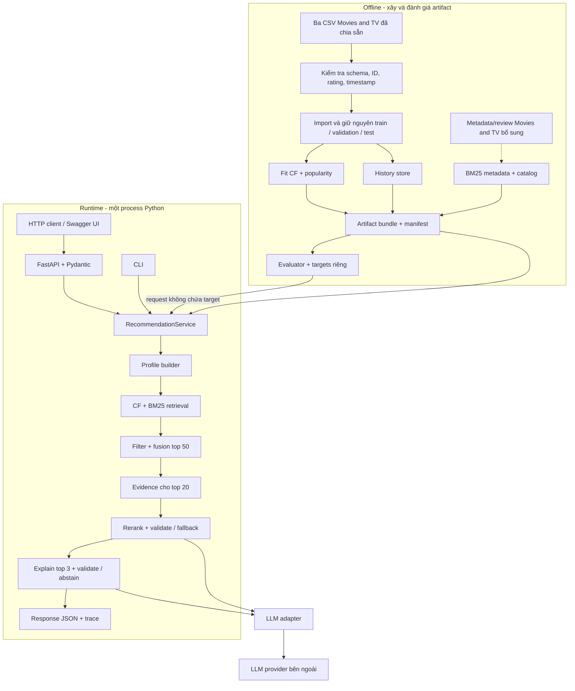
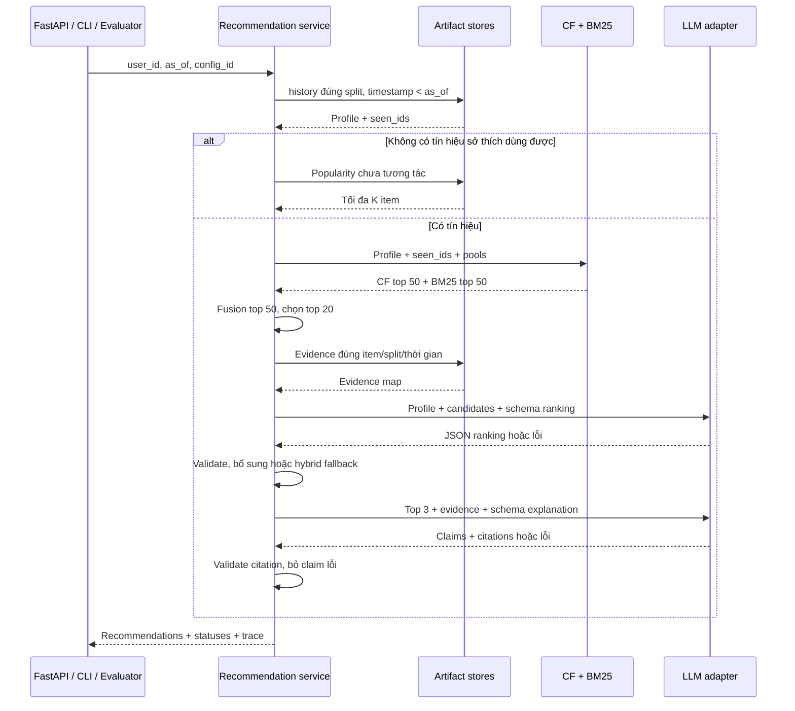

# Kiến trúc hệ gợi ý phim và chương trình truyền hình RAG–LLM

> **Trạng thái:** pipeline nhập dữ liệu và CF đã có trong `backend/`; BM25, evidence store, LLM và API còn là thiết kế đề xuất để triển khai [proposal.md](proposal.md). Phạm vi: pipeline thí nghiệm + FastAPI server + CLI; không yêu cầu web, microservice hay fine-tune LLM.

**Hợp đồng chính:** nhận `user_id` + `as_of`, trả tối đa 10 sản phẩm Movies and TV chưa tương tác; giải thích tối đa ba sản phẩm đầu bằng nguồn truy xuất được. Item là `parent_asin`, có thể đại diện cho phim, chương trình hoặc một sản phẩm phát hành liên quan. LLM chỉ xếp hạng item đã truy xuất.

## 1. Đánh giá hiện trạng và quyết định thiết kế

| Nội dung | Đánh giá / quyết định |
|---|---|
| Tách retrieval, rerank, explanation | Giữ; đo riêng chất lượng và chi phí từng khâu |
| CF + BM25 | Giữ; BPR-MF chính, Popularity fallback; BM25 dùng metadata tĩnh |
| Chống rò rỉ dữ liệu | Chốt `timestamp < as_of` cho mọi history/review; tie-break không cho phép dùng sự kiện cùng timestamp |
| Hợp đồng module | Bổ sung kiểu dữ liệu, input/output và điều kiện nghiệm thu |
| Độ tin cậy LLM | Kiểm tra schema/ID/citation khi chạy; chấm claim–evidence riêng trong đánh giá |
| Triển khai | Một process Python, artifact cục bộ bất biến; chỉ adapter LLM gọi ra ngoài |

### 1.1 Kiểm tra dữ liệu thực tế — điều kiện phải giải quyết trước BM25

Đếm số dòng trực tiếp trong ba file CSV tại `dataset/2023/` ngày 08/10/2026:

| Chỉ số | Giá trị |
|---|---:|
| Train | 6.126.723 dòng |
| Validation | 657.203 dòng |
| Test | 657.203 dòng |
| Tổng | 7.441.129 dòng |
| Schema | `user_id`, `parent_asin`, `rating`, `timestamp`, `history` |
| Metadata/review text Movies and TV | Chưa có trong workspace |

**Hệ quả:** có thể chạy CF trên các split có sẵn, nhưng chưa thể chạy BM25, evidence retrieval hoặc đánh giá giải thích. Hai file Digital Music còn trong thư mục không tương thích với Movies and TV và không được nối vào catalog phim.

**Cổng dữ liệu:** `import-splits` kiểm tra schema/giá trị, giữ nguyên split và xuất hash nguồn. Chỉ chạy so sánh hybrid khi metadata/review Movies and TV tương thích đã được audit và catalog thí nghiệm có text dùng được. Nếu chọn tập giao có metadata, phải lọc lại cả ba split và chạy lại **tất cả baseline trên cùng catalog**; chỉ có ID không được tính là metadata đủ dùng.

## 2. System design



| Thành phần | Trách nhiệm / ranh giới |
|---|---|
| Offline jobs | Làm sạch, split, fit/index, xuất bundle; không chạy lại khi có query |
| Artifact loader | Kiểm tra hash, schema, pha đánh giá; load CF/BM25 một lần khi khởi động |
| FastAPI router | Validate HTTP bằng Pydantic, gọi service, ánh xạ response/lỗi; không chứa thuật toán gợi ý |
| RecommendationService | Điều phối query, timeout, fallback; dùng chung cho CLI, evaluator và API |
| CF / text retriever | Chỉ trả ID + điểm; không gọi LLM |
| Evidence store | Truy xuất nguồn theo item, split và thời gian; không dùng file raw tại runtime |
| LLM adapter | Render prompt, giới hạn token, gọi model, thu usage; không có quyền đọc target hoặc chạy tool |
| Validator | Kiểm tra ranking/citation; không tuyên bố kiểm chứng ngữ nghĩa chỉ nhờ citation hợp lệ |
| Evaluator | Giữ target/label riêng, ghép với output sau inference; không gửi target vào service |

**Lưu trữ đề xuất:** Parquet cho dữ liệu và kết quả theo lô; SQLite cho catalog/history/review tra theo khóa; file model/index cho CF/BM25; JSON cho manifest/config. Không cần vector database ở cấu hình chính.

**Triển khai demo:** chạy cục bộ trên một máy, index/model trong RAM nếu vừa; review giữ trong SQLite. Đo RAM và thời gian load trước khi chốt cấu hình máy. Chỉ nạp bundle hoàn chỉnh; chuyển phiên bản bằng khởi động lại service. FastAPI chạy một worker, bind localhost mặc định; public deployment ngoài phạm vi. Router gọi service trong process; CLI/evaluator gọi trực tiếp cùng service, không cần HTTP. Giới hạn một pipeline gợi ý đang chạy trong demo ban đầu; request vượt giới hạn nhận 429 để tránh tăng RAM và số call LLM ngoài dự kiến.

## 3. Dữ liệu và giao thức thời gian

### 3.1 Pipeline offline: input → xử lý → output

| Bước | Input | Xử lý chính | Output / điều kiện hoàn thành |
|---|---|---|---|
| D0 — Audit source contract | Ba CSV đã chia sẵn | Kiểm tra header, ID, rating, timestamp, target không nằm trong `history` | Thống kê dòng và hash từng nguồn |
| D1 — Import splits | Ba CSV hợp lệ | Ánh xạ `parent_asin` → `item_id`; giữ timestamp mili-giây và nhãn split nguồn | `splits.parquet`, catalog ID, thống kê import |
| D2 — Build queries | Validation và test | Tách target khỏi request phục vụ; giữ target chỉ cho evaluator | `queries_val.parquet`, `queries_test.parquet` |
| D3 — Enrich catalog | Metadata/review Movies and TV tương thích | Audit độ phủ theo `parent_asin`, chuẩn hóa text; chưa chạy khi thiếu nguồn | Catalog/evidence có text hoặc CF-only catalog được ghi rõ |
| D4 — Build validation | Train + catalog | Fit CF/popularity, xây BM25 metadata và store train | Bundle `val-v1`; không có review validation/test |
| D5 — Tune | Bundle validation + query/target validation | Chọn CF, alpha, config retrieval; khóa prompt/budget | `locked_config.json`, `validation_metrics.csv` |
| D6 — Build test | Train + validation + config đã khóa | Refit CF/popularity; review/history store train+validation; không thêm test | Bundle `test-v1`, manifest và checksum |
| D7 — Evaluate | Bundle test + query test | Chạy baseline và mẫu LLM cố định; evaluator ghép target sau inference | Prediction JSONL, metrics CSV, báo cáo lỗi/chi phí |

Khi bổ sung metadata, khóa nối duy nhất là `parent_asin`. Không ghép gần đúng bằng title và không coi ngày trong metadata là thời điểm item xuất hiện trên catalog nếu nguồn không xác nhận.

### 3.2 Quy tắc chống rò rỉ và tính hợp lệ

| Dữ liệu | Validation | Test |
|---|---|---|
| CF/popularity fit | Train | Train + validation sau khi khóa tham số |
| History của user | Train, `timestamp < as_of` | Train + validation, `timestamp < as_of` |
| Review evidence | Train, `timestamp < as_of` | Train + validation, `timestamp < as_of` |
| Metadata/BM25 | Catalog tĩnh đã chốt | Cùng định nghĩa catalog và text processing |
| Target | Chỉ evaluator đọc validation | Chỉ evaluator đọc test |

- `as_of` bằng timestamp target. Tie-break chỉ xác định split; **mọi sự kiện cùng timestamp target đều bị loại khỏi history/evidence**. Không dùng tie-break để giả định thứ tự trong cùng thời điểm.
- Split nguồn đã được tạo trước khi import; importer không chia lại. Cần audit riêng tính duy nhất của cặp user–item trước khi chạy thí nghiệm chính vì CF từ chối cặp trùng trong tập fit.
- `seen_ids` chứa mọi item trong history hợp lệ, kể cả rating thấp. Candidate = catalog trừ `seen_ids`; không lọc dựa trên target.
- Metadata là catalog tĩnh: không khẳng định item đã có mặt trên thị trường tại `as_of`.
- Split tuần tự theo user **không causal hoàn toàn**: CF/popularity có thể học sự kiện của user khác sau `as_of`. Đây là giới hạn của thí nghiệm chính. Mở rộng causal cần snapshot toàn cục có cutoff không sau thời điểm query và fit lại mọi artifact học từ tương tác.
- BM25 chính chỉ index metadata. Nếu thêm review: dùng snapshot hợp lệ cả split và thời gian, kể cả thống kê IDF; lọc kết quả sau khi chấm trên index chứa review tương lai là chưa đủ.

### 3.3 Schema và artifact

| Artifact / kiểu dữ liệu | Trường bắt buộc | Khóa / quy tắc |
|---|---|---|
| `Interaction` | user_id, item_id, rating, timestamp, review_id, split | `item_id` lấy từ `parent_asin`; timestamp mili-giây |
| `CatalogItem` | item_id, title nullable, metadata_text, source_id | item_id duy nhất; không bịa title thiếu |
| `Review` | review_id, user_id, item_id, timestamp, rating, text, split | Index `(item_id,timestamp)`; loại text rỗng |
| `Profile` | user_id, history_ids, seen_ids, positive_terms, negative_item_ids, history_sources | Nguồn `[H1]…` tách khỏi evidence item |
| `Candidate` | item_id, cf_score nullable, bm25_score nullable, hybrid_score nullable, source | ID duy nhất, thuộc catalog, chưa thấy |
| `Evidence` | evidence_id, item_id, source_type, source_id, timestamp nullable, text | `[E1]…` duy nhất trong request; metadata có timestamp null |
| CF/index | Model, user/item mappings, tokenizer config | Mapping/hash catalog khớp manifest |
| `manifest.json` | artifact_version, phase, raw/split/catalog hashes, seed, config hash, code version, schema version, model/prompt versions | Không trộn artifact khác pha hoặc khác catalog |

Bundle lưu tại `artifacts/<version>/`; kết quả lưu tại `runs/<run_id>/`. Với dữ liệu hiệu dụng, store history/review **không chứa split bị cấm**, ngoài kiểm tra filter lúc query. SQLite index history theo `(user_id,timestamp)`.

## 4. Luồng một query



### 4.1 Hợp đồng từng bước

| Bước / module | Input | Xử lý | Output |
|---|---|---|---|
| Q0 `validate_request` | Request + manifest | Kiểm tra user/as_of/config, bundle và pool | `QueryContext` hoặc lỗi request |
| Q1 `build_profile` | Context + history/catalog | Lấy tối đa 20 item thích gần nhất, rating ≥4; rating ≤2 làm tín hiệu tránh; review/text có giới hạn | `Profile`, tập `seen_ids` đầy đủ, nguồn H |
| Q2 `retrieve` | Profile + seen + models | CF/BM25 mỗi nhánh tối đa 50 item chưa thấy | Hai danh sách `Candidate` có điểm gốc |
| Q3 `fuse` | Hai danh sách + alpha + popularity | Hợp nhất ID, rank fusion, phá hòa bằng item_id; bổ sung nếu thiếu | Hybrid top 50, rerank pool tối đa 20 |
| Q4 `retrieve_evidence` | Top 20 + profile + context | Metadata và tối đa 2 đoạn review/item của người khác; lọc trước khi chọn đoạn | Candidates + evidence map trong token budget |
| Q5 `rerank` | Profile + top 20 + evidence | LLM chọn K ID, kiểm tra và fallback | K ID hợp lệ + `rerank_status` |
| Q6 `explain` | Top min(3,K) + nguồn H/E | Sinh tối đa 2 claim/item; kiểm tra nguồn; render 1–2 câu | Explanation hoặc null + trạng thái từng item |
| Q7 `respond` | Ranking + explanation + trace | Ghép title từ catalog, ghi JSONL/usage | Response JSON; metrics riêng cho evaluator |

**Q0:** $1 \le top\_k \le rerank\_pool \le hybrid\_pool$, mọi pool có giới hạn trong config; $0 \le \alpha \le 1$. Config chuẩn: `10 / 20 / 50`, CF=50, BM25=50. Request không được đổi config thí nghiệm đã khóa. User lạ hoặc không có tín hiệu CF/text dùng được → popularity và `cold_start`; không gọi LLM.

**Q1:** rating 3 là trung tính, vẫn thuộc seen. BM25 query chỉ lấy từ item thích, không ghép keyword của item ghét như tín hiệu dương. Tokenizer/lowercase/stopword giống khi xây index. Profile rỗng không được làm BM25 trả các item điểm 0 tùy ý.

**Q2:** BPR-MF học positive từ rating ≥4; backend `implicit` sample negative
trong catalog ngoài tập positive **ở tập fit**, không đọc held-out để chọn
negative. Item rating ≤3 có thể được sample làm negative nhưng vẫn bị lọc khỏi
recommendation theo history. Item không có embedding vẫn có thể được BM25 lấy;
không gán điểm CF giả. Top-N
phải chọn sau lọc seen; BM25 loại kết quả không có điểm dương.

**Q3 — công thức chốt:** với nhánh trả $N$ item, $rank\_score = (N - rank + 1) / N$, rank bắt đầu từ 1; item vắng mặt nhận 0. $hybrid\_score = \alpha \times cf\_rank\_score + (1-\alpha) \times bm25\_rank\_score$. Nhánh rỗng không tính phép chia. Nếu chỉ còn một nhánh dùng được, xếp theo nhánh đó. Các item popularity bổ sung đặt **sau** item retrieval, theo số positive giảm dần rồi item_id tăng dần; không pha điểm khác thang đo. Catalog ít hơn $K$ item hợp lệ → trả số còn lại.

**Q4:** review phải thuộc split được phép, `timestamp < as_of`, author khác user query; xếp đoạn bằng độ khớp keyword và phá hòa theo review_id. Metadata cũng cần source_id đến đúng field. Giới hạn 2 đoạn/item, mỗi đoạn tối đa 120 token; tổng prompt còn bị chặn bởi budget chung. Khi quá budget, bỏ review ít liên quan trước, giữ ID của toàn bộ candidate; không cắt JSON giữa chừng.

**Q5 — JSON LLM:** `{"item_ids":["ID_A","ID_B"]}`. ID lạ, ID trùng, quá $K$, sai schema hoặc timeout → dùng hybrid top $K$; output đúng nhưng thiếu $K$ → nối item chưa chọn theo hybrid rank. Toàn bộ output cuối thuộc **rerank pool**, kể cả fallback. Số item cần trả là $K = \min(top\_k, \text{số ứng viên hợp lệ})$.

**Q6 — JSON LLM:** `{"items":[{"item_id":"ID_A","claims":[{"text":"...","evidence_ids":["E1"],"history_ids":[]}]}]}`. Validator kiểm tra item thuộc top 3, ID nguồn tồn tại và đúng item, history thuộc profile. Renderer tự chèn citation từ ID đã kiểm tra. Claim về sở thích cần H; claim về sản phẩm cần E; claim liên hệ hai bên cần cả hai. Nguồn review phải diễn đạt là ý kiến người đánh giá. Không có claim hợp lệ → `explanation: null`, `evidence_unavailable`. Citation hợp lệ chỉ xác nhận liên kết nguồn, chưa chứng minh claim đúng về ngữ nghĩa.

## 5. Interface, lỗi và vận hành

### 5.1 Request / response

CLI đề xuất: `python -m backend.cli recommend --user-id u17 --as-of 1500000000000 --config test-v1`.
FastAPI cung cấp `POST /recommend`, cùng request/response như service. Các ID và số đo sau chỉ minh họa; response rút gọn một item.

| Endpoint | Input | Output / hành vi |
|---|---|---|
| `POST /recommend` | JSON `user_id`, `as_of`, `config_id` | Chờ pipeline hoàn thành, trả response JSON; fallback hợp lệ vẫn HTTP 200 với status/warnings |
| `GET /health` | Không | HTTP 200 nếu sẵn sàng, 503 nếu chưa; trả readiness và các config/artifact đã nạp |
| `GET /docs` | Không | Swagger UI để nhập request và demo |

**Ý nghĩa `config_id`:** khóa tra bộ cấu hình đã đăng ký phía server, ví dụ `test-v1`. Cấu hình chứa `artifact_version`, các pool, alpha, model/prompt và token/timeout budget. `artifact_version` định danh model/index/store đã xây; `config_id` định danh cách chạy trên các artifact đó. Config không chứa API key; key được đọc từ môi trường server. Client không truyền đường dẫn artifact hay tự đổi tham số thí nghiệm. Config không tồn tại → HTTP 422.

**Vòng đời server:** khi khởi động, đọc registry cấu hình, kiểm tra manifest/hash và nạp những bundle đã đăng ký một lần. Chỉ nhận query sau khi sẵn sàng; bundle dùng chung được đọc bất biến, profile/evidence/trace thuộc riêng từng request. Nếu nạp lỗi, giữ readiness=false và từ chối recommend bằng 503; không phục vụ bằng artifact nạp dở. Khi dừng, đóng store và LLM client.

**Ranh giới thực thi:** endpoint không chạy train/index hay đánh giá hàng loạt. Chạy tính điểm CPU trong worker thread giới hạn để không chặn vòng xử lý HTTP; LLM adapter có timeout và deadline. Chưa cần queue hay job polling cho demo. Lỗi ngoài dự kiến trả HTTP 500 kèm request_id, chi tiết lưu trong log server.

```json
{
  "user_id": "u17",
  "as_of": 1500000000000,
  "config_id": "test-v1"
}
```

```json
{
  "request_id": "req-001",
  "user_id": "u17",
  "as_of": 1500000000000,
  "artifact_version": "test-v1",
  "config_id": "test-v1",
  "status": "ok",
  "warnings": [],
  "rerank_status": "llm_valid",
  "recommendations": [
    {
      "rank": 1,
      "item_id": "ID_A",
      "title": "Example Movie",
      "source": "hybrid",
      "hybrid_score": 0.87,
      "explanation": "Mô tả ghi nhận đây là bản thu trực tiếp [E1].",
      "explanation_status": "citations_valid",
      "evidence_ids": ["E1"],
      "history_ids": []
    }
  ],
  "evidence": {
    "E1": {
      "item_id": "ID_A",
      "source_type": "metadata",
      "source_id": "catalog:ID_A:description",
      "timestamp": null,
      "text": "Recorded live ..."
    }
  },
  "history_sources": {},
  "trace": {
    "model_id": "configured-model",
    "prompt_version": "v1",
    "cache_hit": false,
    "latency_ms": {"total": 1200, "retrieval": 18, "rerank": 730, "explain": 410},
    "llm_calls": [
      {"stage": "rerank", "input_tokens": 1800, "output_tokens": 80},
      {"stage": "explain", "input_tokens": 600, "output_tokens": 140}
    ]
  }
}
```

Response thật trả K item; ngoài top 3: explanation=null, IDs rỗng, `explanation_status=not_requested`. Điểm retrieval là điểm xếp hạng, không phải xác suất. `status=ok|degraded`; warnings có thể đồng thời chứa `cold_start`, `insufficient_catalog`, `cf_unavailable`, `llm_timeout`. Trạng thái riêng: rerank=`llm_valid|llm_completed|hybrid_fallback|skipped`; explanation=`citations_valid|evidence_unavailable|generation_failed|not_requested`.

### 5.2 Failure flow và ngân sách

| Tình huống | Hành vi xác định |
|---|---|
| Request sai kiểu/phạm vi | Từ chối, không gọi LLM; API 422 |
| Bundle thiếu, sai hash hoặc khác pha | Dừng load; API 503; không âm thầm trộn artifact |
| User lạ / không có tín hiệu | Popularity chưa thấy, cold_start, bỏ LLM |
| Một retriever lỗi/rỗng | Dùng nhánh còn lại; ghi warning nếu lỗi |
| Cả hai lỗi/rỗng / thiếu candidate | Bổ sung popularity; nếu catalog thiếu thì trả ít hơn K |
| LLM rerank lỗi | Hybrid top K; vẫn có thể giải thích nếu còn budget |
| LLM explanation lỗi | Giữ ranking; explanation=null, generation_failed |
| Citation lỗi / thiếu evidence | Bỏ claim lỗi; không sửa bằng nguồn không liên quan |

Config demo ban đầu: timeout 20 giây/call, tối đa 2 LLM call/query, **không retry tự động**, deadline tổng 45 giây. Khi hết thời gian, trả kết quả fallback đang có. Budget input mỗi call 6.000 token, output rerank 512, explanation 768; adapter phải kiểm tra phù hợp context window model đã chọn. Đây là giới hạn thiết kế, không phải latency đã đo. Chạy thí nghiệm tuần tự ban đầu để kiểm soát usage; tăng concurrency chỉ sau khi đo.

- Không gửi reviewerName/email hoặc raw user_id cho provider; chỉ gửi profile rút gọn, candidate và đoạn nguồn cần dùng. Review/metadata là dữ liệu không tin cậy, được phân cách khỏi instruction; LLM không có tool để thực hiện nội dung trong review.
- Log ID/hash, trạng thái, số candidate, latency từng Q0–Q7 và usage từng call; không log API key. Nếu provider không trả usage, lưu null, không ghi 0 như số đo thật.
- Cache theo hash request + artifact/config + prompt/model + nội dung input đã render. Lưu raw LLM response trong thư mục chạy được kiểm soát để replay/debug; không ghi vào Git. Model/nhiệt độ cố định không bảo đảm provider trả giống tuyệt đối.
- Báo latency cache hit/miss riêng. Cache hit có số call phát sinh bằng 0; usage nguồn lưu riêng, không tính lại thành chi phí của lần chạy mới.

## 6. Thiết kế thực nghiệm

| Run | Retrieval | Rerank | Explanation | Mục đích |
|---|---|---|---|---|
| A | Popularity | Không | Không | Mốc không cá nhân hóa |
| B | CF | Không | Không | Mốc collaborative |
| C | BM25 | Không | Không | Mốc text |
| D | CF + BM25 | Không | Không | Đóng góp hybrid so với B/C |
| E | Cùng pool của D | LLM | Không ép citation | Đóng góp rerank so với D |
| F | Cùng pool và ranking của E | Tái dùng kết quả E | Ép citation + validator | Đóng góp ràng buộc giải thích so với E |

E/F dùng cùng profile/evidence/model và budget; chỉ đổi prompt/schema/validator giải thích. Tái dùng ranking để tránh nhiễu khi so sánh citation; báo chi phí rerank dùng chung và tổng chi phí logic của mỗi cấu hình. Ablation bỏ text cần xây lại pool; không tuyên bố pool giống D khi retriever đã thay đổi.

**Tập đánh giá:** A–D chạy toàn test; A–F chạy thêm cùng mẫu `min(200, số user hợp lệ)` chọn bằng seed đã khóa. Không chọn mẫu theo việc CF tìm trúng target. Mỗi user một target; metric chính đo dự đoán **tương tác kế tiếp**, kể cả rating thấp, không gọi đó là dự đoán thích. Báo thêm kết quả trên nhóm target rating ≥4 cùng kích thước nhóm để phù hợp mục tiêu sở thích.

| Nhóm metric | Định nghĩa / cách báo |
|---|---|
| Ranking | HR@10 = Recall@10 với một target; NDCG@10 = 1/log2(rank+1) nếu target nằm top 10, ngoài ra 0 |
| Retrieval | Candidate Recall@20/50 trước LLM; tính cả target không truy xuất được là miss |
| Citation | Số citation tồn tại, đúng item / tổng citation; mẫu số 0 → N/A |
| Claim support | Số claim được nguồn hỗ trợ / tổng claim đã sinh; chấm bằng rubric/prompt cố định, đối chiếu thủ công 30–50 response |
| Coverage | Item có explanation / số item được yêu cầu giải thích; báo abstention để tránh tăng support bằng cách không nói gì |
| Vi phạm | ID ngoài pool, duplicate, schema lỗi trước validator; vi phạm còn lọt ở output cuối phải bằng 0 |
| Vận hành | Fallback rate, error rate, p50/p95 latency, input/output token và số call thực tế; tách cache hit/miss |

Lưu cả output trước/sau validator cho E/F để đo tác động lọc. So sánh LLM với baseline trên **cùng mẫu**, không đối chiếu trực tiếp LLM-200 với baseline-toàn-test. Tham số, rubric và prompt được khóa trên validation; test chỉ dùng báo kết quả.

## 7. Cấu trúc triển khai và kế hoạch nghiệm thu

Cấu trúc dưới đây là **đề xuất**, chưa phải file đã tồn tại:

```text
backend/
  app.py                    # FastAPI app, startup/shutdown, readiness
  api/
    routes.py               # POST /recommend, GET /health
  schemas.py                # Pydantic request/response + kiểu dữ liệu nội bộ
  config.py                 # registry config_id, kiểm tra artifact và giới hạn
  data/                     # audit, normalize, split, build_store
  training/                 # fit_cf, popularity, build_bm25
  retrieval/                # profile, cf, bm25, fusion, evidence
  generation/               # adapter, prompts, rerank, explain, validators
  service.py                # RecommendationService điều phối Q0–Q7
  evaluate.py               # query runner, ranking/faithfulness metrics
  cli.py                    # prepare, train, recommend, evaluate
configs/                    # validation, test, model và budgets
artifacts/<version>/        # manifest, tables/store, models/index
runs/<run_id>/              # predictions, traces, metrics, report
tests/                      # kiểm tra hợp đồng, leakage và fallback
```

| Mốc | Input bắt buộc | Công việc | Output bàn giao | Tiêu chí nghiệm thu |
|---|---|---|---|---|
| M0 — Đầu tuần 1 | Raw review + metadata | Audit, xác minh nguồn, chốt catalog | `data_quality.json`, quyết định dữ liệu | Xử lý rõ độ phủ 1,57%; không chạy hybrid trên catalog ngầm thay đổi |
| M1 — Tuần 1 | Catalog đã chốt + raw | Normalize, deduplicate, split, schema | Bảng dữ liệu, query/target riêng, manifest | Không lặp user–item; history cùng timestamp target bị loại; không test trong bundle |
| M2 — Tuần 1 | Train + validation | Popularity, CF, evaluator | Model + `baseline_metrics.csv` | Một query → top K chưa thấy; metric tính đúng trên ví dụ biết trước |
| M3 — Tuần 2 | Catalog + CF + store | BM25, fusion, evidence | Bundle validation + trace truy xuất | Top 50/20 xác định; evidence đúng item/split/thời gian; kiểm tra item thiếu embedding |
| M4 — Tuần 3 | Pool/evidence + LLM config | Rerank, explanation, validator, FastAPI + CLI | POST /recommend → JSON; /health và Swagger demo | API/CLI cùng hợp đồng; readiness/config lỗi đúng status; ID lạ/trùng, timeout, review chứa instruction không phá đầu ra |
| M5 — Tuần 3 | Config/prompt đã khóa | Refit test, chạy A–F, kiểm tra thủ công | Predictions JSONL, metrics CSV, báo cáo, lệnh demo | Cùng mẫu so sánh; đủ ranking/support/coverage/cost; replay bằng artifact và cache |

**Các kiểm tra bắt buộc:** timestamp trùng target; target user–item lặp trước làm sạch; negative rating vẫn thuộc seen; CF không biết item; BM25 query rỗng; một/cả hai retriever lỗi; catalog dưới K; evidence sai item/split; LLM sai schema/ID; cache khác artifact không dùng chung. Kiểm thử bằng fixture nhỏ, không gọi LLM thật; smoke test tích hợp riêng với số query có giới hạn.

**Mốc tối thiểu hoàn thành:** dữ liệu được kiểm tra → baseline/metric → hybrid/evidence → LLM có fallback → bảng so sánh và demo tái lập. Dense retrieval, review-BM25 snapshot, causal evaluation toàn cục và public API là phần mở rộng sau mốc này.
