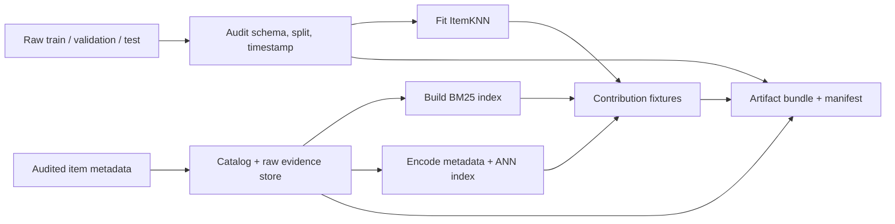
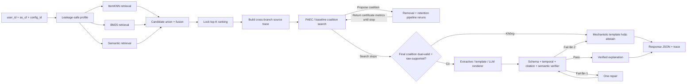

# Mô hình hóa bài toán và thiết kế nghiên cứu

> Tài liệu này đặc tả bài toán, ranker ItemKNN–BM25–Semantic, cơ chế Pipeline-Aware Evidence Coalition (PAEC) và giao thức đánh giá. Định vị novelty và câu hỏi nghiên cứu nằm trong [qa.md](qa.md); quy trình literature audit nằm trong [literature_audit.md](literature_audit.md).

## 0. Kết luận related work và novelty

Các ranh giới trực tiếp không chỉ gồm PROVE-Rec và HARE-Rec. [EviSnap](https://arxiv.org/abs/2604.06172) đã có exact additive contribution, verbatim evidence, deletion và sufficiency; CountER, PRINCE, ACCENT và Yao et al. đã có minimal counterfactual/history deletion; LXR, Refining Fidelity Metrics và SPINRec đã có counterfactual attribution cùng removed/retained-history metrics ở explanation length cố định; TRACE và benchmark năm 2026 đã có top-$K$/list-level counterfactual evaluation. Vì vậy, exact provenance, citation, deletion, retention/sufficiency, fixed-budget metric và top-$K$ intervention đều không mới khi xét riêng.

Đề tài chuyển trọng tâm sang một câu hỏi hẹp hơn: **exact contribution của lần chạy gốc lệch với full-pipeline decision influence ở mức nào khi raw source tác động đồng thời lên nhiều retriever, candidate union và query-local normalization?**

Cơ chế dự kiến là PAEC:

1. gom mọi derived atom ở ba nhánh theo raw history source;
2. đo attribution–intervention gap bằng rerun toàn pipeline;
3. chọn source coalition được kiểm tra hai chiều bằng removal và retention;
4. chỉ verbalize coalition có raw-span support, với extractive/template/LLM renderer nhận cùng input.

Đây là đóng góp về **methodological mechanism và controlled empirical study**, không phải recommender algorithm nền tảng mới. Nếu gap không tồn tại hoặc PAEC không thắng baseline, kết quả phải được báo như null result.

## 1. Mục tiêu và phạm vi

### 1.1 Mục tiêu

Với lịch sử tương tác của một người dùng tại thời điểm dự đoán, hệ thống cần:

1. trả về danh sách top-$K$ item chưa tương tác;
2. giữ nguyên thứ hạng do ranker không phải LLM tạo ra;
3. chọn một raw-source coalition nhỏ và kiểm tra ảnh hưởng bằng rerun toàn pipeline;
4. sinh lời giải thích có citation đến raw history, raw metadata và provenance record;
5. kiểm tra từng claim và abstain khi evidence không đủ.

Nghiên cứu không tối ưu một LLM recommender. LLM chỉ là một verbalizer có ràng buộc.

### 1.2 Phạm vi dữ liệu

- Dataset: Amazon Reviews 2023 — Movies and TV.
- Split: giữ nguyên train, validation và test tuần tự hiện có.
- Item ID: `parent_asin` được ánh xạ nhất quán sang `item_id`.
- Tín hiệu hành vi: rating và timestamp.
- Tín hiệu văn bản chính: metadata đã audit của item.
- Review text: không thuộc core experiment cho tới khi có nguồn Movies and TV tương thích và qua audit.
- Metadata aggregate có khả năng chứa tương lai như `average_rating` hoặc `rating_number` không được dùng làm query feature hoặc evidence.

### 1.3 Ranh giới nhân quả

Đề tài đo faithfulness đối với hàm xếp hạng đã cài đặt. Việc xóa history hoặc evidence rồi chạy lại ranker là một model-behavior intervention, không chứng minh ảnh hưởng nhân quả tới sở thích hay hành vi thật của người dùng.

## 2. Ký hiệu và phát biểu bài toán

Gọi:

- $u$ là người dùng;
- $t$ là thời điểm dự đoán `as_of`;
- $I$ là catalog item;
- $H_u(t)$ là lịch sử hợp lệ của $u$ trước $t$;
- $S_u(t)$ là tập item đã tương tác trước $t$;
- $I_u^-(t)=I\setminus S_u(t)$ là tập candidate chưa tương tác;
- $K$ là số item cần trả về;
- $m$ là evidence budget tối đa cho một item;
- $L_u^K(t)$ là danh sách top-$K$ cuối cùng.

Tập lịch sử dương dùng để tạo preference signal là:

$$
H_u^+(t)=\{i\mid r_{u,i}\ge 4,\;t_i<t\}.
$$

Rating 1–2 chỉ được dùng để loại item đã xem trong core experiment. Không được diễn đạt negative preference như một nguyên nhân của rank nếu ranker không sử dụng tín hiệu đó.

Bài toán ranking là xây hàm score $s(u,j,t)$ cho mọi $j\in I_u^-(t)$, sau đó chọn:

$$
L_u^K(t)=\operatorname{TopK}_{j\in I_u^-(t)}s(u,j,t).
$$

Bài toán explanation là tìm coalition $E_{u,j}\subseteq H_u^+(t)$, với $|E_{u,j}|\le m$, sao cho coalition làm target rời top-$K$ khi bị bỏ, giữ target trong top-$K$ khi đứng một mình, có retention loss nhỏ và có raw evidence đủ để hỗ trợ claim. Derived provenance atoms $P(E_{u,j})$ chỉ là trace của coalition, không phải đơn vị intervention chính. Nếu coalition không đạt dual-validity hoặc support gate đã khóa, output phải là mechanistic template thận trọng hoặc abstention.

## 3. Input

### 3.1 Input của một query

| Trường | Kiểu | Ý nghĩa |
|---|---|---|
| `user_id` | string | Người dùng cần gợi ý |
| `as_of` | timestamp | Chỉ history có `timestamp < as_of` được dùng |
| `config_id` | string | Cấu hình artifact, fusion weight và threshold đã khóa |
| `top_k` | integer | Số recommendation cần trả; bị giới hạn bởi config |

Target validation/test không nằm trong request. Chỉ evaluator được đọc target sau khi inference kết thúc.

### 3.2 Input artifact

| Artifact | Nội dung |
|---|---|
| Interaction store | `user_id`, `item_id`, rating, timestamp, split, source ID |
| Catalog | `item_id`, title và các metadata field được phép |
| ItemKNN artifact | Sparse interaction matrix, similarity matrix, mapping và config |
| BM25 artifact | Tokenizer, inverted index, IDF và mapping term về metadata source |
| Semantic artifact | Encoder version, item embedding, ANN index và raw text hash |
| Experiment config | Fusion weight, pool size, evidence budget, threshold và seed |
| Manifest | Schema version, source hash, catalog hash, model version và code version |

### 3.3 User profile

`Profile(u,t)` chứa:

- toàn bộ `seen_ids` hợp lệ để lọc candidate;
- các positive history item trong $H_u^+(t)$;
- rating, timestamp và source ID của từng interaction;
- metadata source dùng để tạo BM25 query và semantic representation;
- trọng số history $\rho_{u,i}$ đã khóa, chẳng hạn uniform hoặc recency-decay.

Không dùng target item, test interaction hoặc evidence sau `as_of` để xây profile.

## 4. Ranker ba nhánh có provenance

### 4.1 ItemKNN

Với $x_{u,i}$ là giá trị interaction dương của history item $i$ và $\operatorname{sim}_{CF}(i,j)$ là item–item similarity không âm đã khóa:

$$
s_{CF}(u,j)=\sum_{i\in H_u^+(t)}x_{u,i}\operatorname{sim}_{CF}(i,j).
$$

Contribution chính xác của history item $i$ là:

$$
c_{CF}(u,i\rightarrow j)=x_{u,i}\operatorname{sim}_{CF}(i,j).
$$

Do score cộng theo history item, không cần dùng SHAP cho nhánh này. Nếu implementation tạo similarity âm, phải clip ở mức từng edge trước phép cộng hoặc lưu một clipping residual atom; không được clip tổng score rồi vẫn nhận decomposition theo source là exact.

### 4.2 BM25

BM25 query $q_u$ được tạo từ metadata của các item trong $H_u^+(t)$. Score được phân rã theo query term:

$$
s_{BM25}(u,j)=\sum_{w\in q_u}c_{BM25}(u,w\rightarrow j).
$$

Mỗi term $w$ phải lưu:

- history item và metadata field đã sinh ra term;
- candidate field khớp term;
- raw BM25 contribution;
- tokenizer và index version.

Nếu cùng term đến từ nhiều history item, dùng một quy tắc phân bổ $a_{u,i,w}\ge 0$ đã khóa sao cho $\sum_i a_{u,i,w}=1$:

$$
c_{BM25}(u,i,w\rightarrow j)
=a_{u,i,w}c_{BM25}(u,w\rightarrow j).
$$

Quy tắc này tránh đếm lặp contribution của một term.

### 4.3 Semantic search

Metadata của item $i$ được tách tất định thành các field hoặc chunk $D_i=\{d_{i,b}\mid b\in B_i\}$; semantic search dùng encoder cố định $f(\cdot)$ để tạo $e_{i,b}=f(d_{i,b})$. Tương đồng item–item được lấy từ cặp chunk tốt nhất:

$$
\operatorname{sim}_{SEM}(i,j)=
\max_{b\in B_i,\,c\in B_j}
\max\bigl(0,\cos(e_{i,b},e_{j,c})\bigr).
$$

Để giữ provenance cộng tính, score semantic được định nghĩa ở mức cặp history–candidate thay vì dùng một black-box reranker:

$$
c_{SEM}(u,i\rightarrow j)
=\rho_{u,i}\operatorname{sim}_{SEM}(i,j),
$$

$$
s_{SEM}(u,j)=\sum_{i\in H_u^+(t)}c_{SEM}(u,i\rightarrow j).
$$

Thiết kế này cho phép truy vết mỗi phần score semantic về một history item và một cặp raw chunk cụ thể. ANN có thể được dùng để lấy candidate pool, nhưng score và provenance cuối phải được tính lại tất định trên embedding đã khóa. Chunking rule, pooling rule và tie-break phải nằm trong config.

Một dense match chỉ chứng minh hai representation gần nhau trong không gian embedding. Nó không tự chứng minh một claim như “hai phim cùng chủ đề”. Semantic claim chỉ hợp lệ khi verifier tìm được raw metadata span ở cả hai phía hỗ trợ cùng aspect.

Nếu triển khai semantic model không phân rã được theo history item, nhánh đó chỉ được báo leave-one-out influence và không được gắn nhãn exact contribution.

### 4.4 Candidate union và chuẩn hóa

Ba retriever trả về các pool đã lọc `seen_ids`. Candidate union là:

$$
C_u=C_{CF}\cup C_{BM25}\cup C_{SEM}.
$$

Với $r\in\{CF,BM25,SEM\}$, chuẩn hóa score dương trong cùng query:

$$
\bar{s}_r(u,j)=
\frac{\max(s_r(u,j),0)}
{\epsilon+\sum_{k\in C_u}\max(s_r(u,k),0)}.
$$

Trọng số fusion thỏa $\lambda_{CF}+\lambda_{BM25}+\lambda_{SEM}=1$ và $\lambda_r\ge 0$. Fused score là:

$$
s_{F}(u,j)=
\lambda_{CF}\bar{s}_{CF}(u,j)
+\lambda_{BM25}\bar{s}_{BM25}(u,j)
+\lambda_{SEM}\bar{s}_{SEM}(u,j).
$$

Mỗi raw contribution phải được nhân với fusion weight và mẫu số chuẩn hóa tương ứng trước khi cộng với contribution từ nhánh khác.

Kiểm tra bắt buộc:

$$
\left|s_F(u,j)-\sum_{p\in\mathcal{P}_{u,j}}c_p^F(u,j)\right|<\delta.
$$

Nếu identity này không đạt trên fixture và sample production, provenance chưa hợp lệ.

Về mặt định nghĩa, score có thể được mở rộng trên toàn bộ catalog chưa tương tác, nhưng hệ thống thực tế dùng BM25 và ANN để tạo candidate pool. Intervention chính phải chạy lại đúng pipeline triển khai và được gọi là **full-pipeline influence**. Thuật ngữ **full-catalog influence** chỉ được dùng nếu mọi item trong catalog thực sự được chấm lại chính xác. Nếu giữ nguyên pool ban đầu, metric phải được gọi là **fixed-pool influence**.

## 5. Pipeline-Aware Evidence Coalition

### 5.1 Provenance atom và raw-source group

Một provenance atom $p$ chứa:

- retriever: `itemknn`, `bm25` hoặc `semantic`;
- raw history source ID và candidate source;
- raw score contribution và normalized fused contribution;
- timestamp, artifact version và raw metadata span;
- query/candidate-pool membership tạo ra atom.

Với mỗi history item $i$, đặt:

$$
G_i=\{p\in\mathcal{P}_{u,j}\mid p\text{ được dẫn xuất từ raw source }i\}.
$$

$G_i$ có thể chứa đồng thời ItemKNN edge, nhiều BM25 term và semantic chunk pair. $G_i$ là đơn vị attribution; raw history item $i$ mới là đơn vị intervention. Không xóa một atom riêng lẻ rồi gọi đó là raw-evidence counterfactual.

Biểu diễn serving pipeline bằng dependency DAG $mathcal{G}$, trong đó raw source nối tới profile signal, branch query, candidate membership, score, normalization denominator, boundary competitor và final rank. Với coalition $E$, intervention closure là:

$$
\operatorname{cl}_{\mathcal{G}}(E)
=\bigcup_{i\in E}\operatorname{Desc}_{\mathcal{G}}(g_i).
$$

Một **source-consistent intervention** phải vô hiệu hóa $g_i$ và tính lại mọi node trong $\operatorname{cl}_{\mathcal{G}}(E)$ ở cả ba nhánh. Model parameter, index artifact, config và factual `seen_ids` không phải descendant nên được giữ cố định. Nếu một derived atom từ $E$ còn tồn tại sau intervention, run đó không hợp lệ.

### 5.2 Realized-score attribution

Attribution tĩnh của source $i$ cho item $j$ trong lần chạy gốc là:

$$
A_i(u,j)=\sum_{p\in G_i}c_p^F(u,j).
$$

Nếu mọi phần score được ánh xạ về source, ta có:

$$
s_F(u,j)=\sum_{i\in H_u^+(t)}A_i(u,j).
$$

Đẳng thức này chỉ chứng minh accounting của realized score. Nó không chứng minh $i$ là necessary, sufficient hoặc có removal effect lớn sau khi pipeline được chạy lại.

### 5.3 Signed top-$K$ margin

Với một history state $H$ và target item $j$, định nghĩa signed boundary margin:

$$
\mu_K(j;H)=
\begin{cases}
s_F(j;H)-s_F(j_{K+1};H), & j\in L^K(H),\\
s_F(j;H)-s_F(j_K;H), & j\notin L^K(H).
\end{cases}
$$

Nếu $j$ không được retrieve, score hệ thống của $j$ trong state đó được đặt theo quy ước out-of-pool đã khóa; mặc định là $0$ trước tie-break. Quy ước này phải nhất quán giữa mọi condition.

Margin dương nghĩa là $j$ ở trong top-$K$; margin âm nghĩa là $j$ ở ngoài. Khi score bằng đúng boundary, margin bằng $0$ và membership được quyết định bằng tie-break tất định; vì vậy membership, không phải dấu của margin, là tiêu chuẩn validity. Competitor được xác định lại sau mỗi intervention, không cố định item $j_{K+1}$ của lần chạy gốc.

Một state chỉ evaluable khi pipeline trả ít nhất $K+1$ candidate hợp lệ, hoặc khi production fallback đã khóa trả đủ số đó. Empty query, empty union hoặc ít hơn $K+1$ candidate không được tính như một rank flip thành công; case phải được gắn cờ non-evaluable và báo tỷ lệ riêng.

### 5.4 Removal và retention intervention

Với coalition $E\subseteq H_u^+(t)$:

$$
R^{-}(E;j)=\mu_K(j;H_u^+(t))-\mu_K(j;H_u^+(t)\setminus E),
$$

$$
R^{+}(E;j)=\left|\mu_K(j;H_u^+(t))-\mu_K(j;E)\right|.
$$

- $R^{-}$ lớn là removal/comprehensiveness tốt.
- $R^{+}$ nhỏ là retention loss thấp và bảo toàn factual margin tốt.
- **strict-removal-valid** nếu $j$ rời top-$K$ sau khi bỏ $E$.
- **retention-valid** nếu $j$ vẫn ở top-$K$ khi chỉ giữ $E$ và $R^{+}$ không vượt tolerance.
- **dual-valid** nếu cả strict-removal-valid và retention-valid đều đạt.

Nếu $j$ vẫn ở top-$K$ nhưng $R^{-}$ lớn, kết quả chỉ được báo là soft comprehensiveness; nó không được tính vào strict dual-valid rate.

Một coalition dual-valid tạo **decision certificate**:

$$
Z(E,j)=
\bigl(
\text{run hashes}, E,
\text{membership}_{F,-,+},
\mu_{F,-,+},
\text{boundary}_{F,-,+},
\Delta C_{-},\Delta C_{+}
\bigr),
$$

trong đó $F,-,+$ lần lượt là factual, removal và retention state; $\Delta C$ là candidate-set delta. Natural-language explanation chỉ là renderer của certificate và evidence bundle, không thay thế certificate.

Primary intervention chỉ thay đổi **preference-generating history**. Tập `seen_ids` dùng để loại item đã tương tác luôn được giữ bằng tập của factual run. Quy tắc này ngăn item bị xóa khỏi evidence quay lại làm candidate và tạo rank flip giả. Một secondary sensitivity analysis có thể xóa cả interaction khỏi `seen_ids`, nhưng phải được ghi rõ là full-history intervention và không được trộn với primary result.

Mỗi evaluation của $H_u^+(t)\setminus E$ hoặc $E$ phải dựng lại profile signal, BM25 query, semantic representation, ba candidate pools, candidate union, normalization và ranking trong khi giữ factual `seen_ids`. Nếu chỉ rerank pool cũ, metric phải đổi tên thành fixed-pool removal/retention.

ANN retrieval phải tất định trong evaluation, hoặc được thay bằng exact search trên evaluation subset. Hai factual rerun với cùng input phải có candidate set, score và rank giống hệt nhau; nếu không, effect quan sát được có thể là retrieval noise thay vì intervention effect.

### 5.5 Attribution–intervention gap

Gap được đo bằng nhiều đại lượng bổ sung:

- Kendall's $\tau$ hoặc Spearman correlation giữa $A_i$ và single-source $R^{-}(\{i\};j)$;
- top-$q$ overlap giữa source theo contribution và intervention;
- regret của coalition do contribution selector chọn so với coalition tốt nhất cùng budget;
- tỷ lệ case đổi candidate membership hoặc đổi boundary competitor;
- interaction residual:

$$
\operatorname{Int}(E;j)=R^{-}(E;j)-\sum_{i\in E}R^{-}(\{i\};j).
$$

$\operatorname{Int}>0$ cho thấy synergy theo metric đã định nghĩa; $\operatorname{Int}<0$ cho thấy redundancy. Đây là interaction của pipeline behavior, không phải causal interaction ngoài đời thực.

Để xác định gap phát sinh ở stage nào, mỗi coalition còn được đánh giá qua ba condition lồng nhau:

1. **score-only:** giữ factual candidate union và factual normalization denominator, chỉ tính lại numerator sau source deletion;
2. **fixed-pool:** giữ factual candidate union nhưng tính lại branch score, normalization và boundary;
3. **full-pipeline:** dựng lại query, candidate pools, union, score, normalization và boundary.

Chênh lệch score-only–fixed-pool đo normalization/boundary effect trong pool; chênh lệch fixed-pool–full-pipeline đo candidate-regeneration externality. Đây là operational decomposition của pipeline behavior, không phải causal mediation analysis.

Chỉ full-pipeline condition thỏa source-consistent intervention closure và được dùng để xác nhận validity. Score-only và fixed-pool cố ý đóng băng một phần dependency graph nên chỉ là diagnostic ablation.

### 5.6 PAEC selector

PAEC tìm coalition $E$, $|E|\le m$, theo objective từ điển:

1. dual-validity;
2. full raw-span support cho loại claim dự kiến;
3. coalition nhỏ hơn;
4. removal effect lớn hơn;
5. retention loss nhỏ hơn.

Tương đương, selector tối ưu theo thứ tự từ trái sang phải của tuple:

$$
\left(
\mathbb{1}[\operatorname{dual}(E)],
\mathbb{1}[\operatorname{support}(E)=1],
-|E|,
R^{-}(E;j),
-R^{+}(E;j)
\right).
$$

Để tránh gán cải thiện do support gate cho coalition search, thí nghiệm phải có ablation PAEC decision-only bỏ thành phần support và PAEC support-aware dùng tuple đầy đủ. Nếu không có coalition vừa dual-valid vừa full-supported trong budget, output personalized claim phải abstain.

Với history có kích thước không quá $h_{exact}$, search exhaustive theo từng kích thước coalition tăng dần. Search đánh giá hết tầng hiện tại rồi dừng trước tầng lớn hơn ngay khi tìm được ít nhất một coalition dual-valid qua support gate. Đây vẫn là exact reference theo objective từ điển vì mọi coalition lớn hơn chắc chắn thua về $|E|$; các coalition cùng tầng đều được đánh giá để giữ tie-break theo removal effect và retention loss. Nếu chưa có tầng hợp lệ, search tiếp tục đến hết budget. Quy tắc này không giả định removal effect đơn điệu. Chỉ dùng branch-and-bound theo effect nếu có bound admissible được chứng minh. Với history dài hơn, dùng beam search với cùng stopping rule; beam width được tune trên validation.

Nếu $T_P$ là chi phí một pipeline rerun và $h=|H_u^+(t)|$, exhaustive dual test có chi phí:

$$
O\!\left(2T_P\sum_{\ell=1}^{m}{h\choose \ell}\right),
$$

còn beam search width $b$ có upper bound gần $O(2bmhT_P)$. Mọi method dùng cùng intervention-query budget hoặc phải báo validity–cost curve. Cache chỉ được tái sử dụng khi key gồm user, source subset, intervention type, config và artifact hash.

Hai biểu thức trên là worst case khi không tầng nào trước budget chứa coalition hợp lệ. Nếu tầng hợp lệ nhỏ nhất là $ell^*$, level-wise exact search chỉ đánh giá các tầng từ $1$ đến $ell^*$.

Trên exact subset, báo riêng: validity gap nếu heuristic bỏ lỡ coalition dual-valid; size gap $|E_{heur}|-|E^*|$ khi cả hai dual-valid; và tie-break margin regret khi kích thước bằng nhau. Chỉ gọi heuristic near-minimal khi validity gap bằng $0$ và upper confidence bound của size gap nằm dưới ngưỡng khóa trước.

### 5.7 Baseline selector

| Selector | Đơn vị chọn | Ghi chú |
|---|---|---|
| Contribution | Raw source, xếp theo $A_i$ | Exact accounting baseline |
| Single-source LOO greedy | Raw source, xếp theo $R^{-}(\{i\};j)$ | Không mô hình coalition interaction |
| Counterfactual greedy | Thêm source làm removal margin giảm nhiều nhất ở mỗi bước | Baseline set-based |
| Semantic relevance | Raw source theo verified span similarity | Tối ưu explainability, không decision faithfulness |
| Recency | Raw source mới nhất | Cheap baseline |
| Random | Raw source ngẫu nhiên cùng budget | Sanity check |
| PAEC | Raw-source coalition | Phương pháp đề xuất |

Mọi selector dùng cùng maximum source budget $m$, giải thích cùng frozen recommendation và được đánh giá bằng cùng rerun harness.

Ngoài source budget, selector dùng intervention phải được so dưới cùng maximum số pipeline query; nếu một method vượt budget, kết quả đó được tính là failure/censored chứ không được cho thêm query riêng.

## 6. Output

### 6.1 Recommendation output

Mỗi recommendation chứa:

- rank và `item_id`;
- score từng nhánh và fused score;
- trạng thái explanation;
- atomic claims và citation;
- coalition source IDs, contribution coverage và source budget;
- removal effect, retention loss và dual-validity status;
- factual/removal/retention run hash, boundary competitor và candidate-set delta của decision certificate;
- validation status và warning;
- latency, token và model version khi có LLM.

### 6.2 Evidence bundle

- `[H#]`: history interaction trước `as_of`, gồm item, rating, timestamp và metadata source liên quan;
- `[C#]`: raw metadata field hoặc span của candidate;
- `[P#]`: provenance record gồm retriever, source atom và contribution;
- `[S#]`: cặp raw span hai phía dùng để kiểm tra semantic bridge, nếu có.

### 6.3 Loại claim

| `claim_type` | Nội dung cho phép | Citation bắt buộc |
|---|---|---|
| `mechanistic` | Interaction hoặc term đóng góp vào score qua một nhánh cụ thể | `[H#]`, `[C#]`, `[P#]` |
| `semantic_bridge` | History item và candidate cùng có một aspect được raw text hỗ trợ | `[H#]`, `[C#]`, `[P#]`, `[S#]` |
| `candidate_fact` | Một thuộc tính của candidate | `[C#]` |

Không được biến ItemKNN similarity thành genre, actor hoặc theme nếu raw metadata không hỗ trợ.

### 6.4 JSON minh họa

Các ID và số dưới đây chỉ minh họa schema:

```json
{
  "user_id": "u17",
  "as_of": 1500000000000,
  "recommendations": [
    {
      "rank": 3,
      "item_id": "movie_x",
      "scores": {
        "itemknn": 0.041,
        "bm25": 0.018,
        "semantic": 0.024,
        "fused": 0.083
      },
      "explanation_status": "verified",
      "coalition": {
        "history_source_ids": ["H1", "H4"],
        "source_count": 2,
        "removal_effect": 0.037,
        "retention_loss": 0.006,
        "strict_removal_valid": true,
        "retention_valid": true,
        "dual_valid": true,
        "certificate": {
          "run_hashes": {
            "factual": "run_f",
            "removal": "run_minus",
            "retention": "run_plus"
          },
          "boundary_items": {
            "factual": "movie_b",
            "removal": "movie_c",
            "retention": "movie_d"
          },
          "candidate_delta": {
            "removal_symmetric_difference": 12,
            "retention_symmetric_difference": 27
          }
        }
      },
      "claims": [
        {
          "text": "A positive interaction with Movie A contributes to this recommendation, and the two items share a science-fiction theme.",
          "claim_type": "semantic_bridge",
          "history_citations": ["H1"],
          "candidate_citations": ["C1"],
          "provenance_citations": ["P1", "P2"],
          "semantic_citations": ["S1"]
        }
      ],
      "contribution_coverage": 0.81,
      "validation_status": "passed"
    }
  ]
}
```

### 6.5 Abstention output

```json
{
  "item_id": "movie_y",
  "explanation_status": "abstained",
  "claims": [],
  "abstain_reason": "no_supported_dual_valid_coalition_within_budget",
  "dual_valid": false
}
```

Hệ thống vẫn có thể trả recommendation khi abstain explanation. Không được dùng kiến thức tham số của LLM để lấp phần evidence thiếu.

## 7. High-level design

### 7.1 Offline pipeline



Offline pipeline phải lưu tokenizer, encoder version, mappings, source hash và config để provenance có thể tái tính.

### 7.2 Online pipeline



### 7.3 Trách nhiệm module

| Module | Trách nhiệm | Không được làm |
|---|---|---|
| Profile builder | Lấy history đúng split và `timestamp < as_of` | Đọc target |
| Retrievers | Trả candidate, score và source-level trace | Gọi LLM |
| Fusion | Chuẩn hóa, gộp và xếp hạng tất định | Thay đổi weight sau khi xem test |
| Provenance builder | Tạo atom và kiểm tra score identity | Suy diễn semantic claim |
| Coalition selector | Chọn raw-source coalition theo policy đã khóa | Xóa atom rời khỏi source group hoặc thay item được giải thích |
| Intervention harness | Rerun profile, query, pools, union, normalization và rank | Tái sử dụng fixed pool trong metric full-pipeline |
| Renderers | Tạo extractive/template/LLM output từ cùng coalition | Thêm fact ngoài bundle hoặc rerank |
| Validator/verifier | Kiểm tra schema, thời gian, citation, contribution và entailment | Tự sửa vô hạn |
| Evaluator | Ghép target sau inference và tính metric | Gửi target vào service |

## 8. Validation và fallback

### 8.1 Các lớp kiểm tra

1. **Schema validator:** JSON, ID, duplicate và membership.
2. **Temporal validator:** mọi history evidence có timestamp nhỏ hơn `as_of` và thuộc split được phép.
3. **Citation validator:** citation tồn tại và trỏ đúng user, item, field.
4. **Contribution validator:** mechanistic citation có contribution hợp lệ trong trace.
5. **Coalition validator:** removal/retention run dùng đúng source set và artifact version.
6. **Semantic verifier:** từng atomic claim được kiểm tra với đúng raw source hai phía.

### 8.2 Repair policy

- Cho phép tối đa một lần repair với danh sách lỗi cụ thể.
- Lưu cả output trước và sau repair.
- Nếu vẫn lỗi, chuyển sang deterministic template nếu trace đủ an toàn.
- Nếu trace hoặc semantic support không đủ, abstain personalized explanation.

## 9. Related work và định vị novelty

Quy trình tìm kiếm, tiêu chí include/exclude và ma trận paper đầy đủ nằm trong [literature_audit.md](literature_audit.md). Phần này chỉ giữ các ranh giới tác động trực tiếp tới thiết kế.

### 9.1 Grounding và exact explanation

[PRAG](https://doi.org/10.1609/aaai.v37i11.26618) đã có retrieval-grounded generation; [ALCE](https://aclanthology.org/2023.emnlp-main.398/) đã tách citation correctness và completeness. Quan trọng hơn, [EviSnap](https://arxiv.org/abs/2604.06172) đã có verbatim evidence, exact additive per-concept contributions, deletion và sufficiency. Vì vậy, raw citation, exact accounting và keep/remove test không phải novelty của đề tài.

### 9.2 Counterfactual recommendation

[CountER](https://doi.org/10.1145/3459637.3482420) tối ưu minimal aspect changes và đo necessity/sufficiency. [PRINCE](https://doi.org/10.1145/3336191.3371824), [ACCENT](https://arxiv.org/abs/2105.05008) và [Yao et al.](https://arxiv.org/abs/2211.09752) tìm history subset làm recommendation thay đổi. [From Top-1 to Top-K](https://arxiv.org/abs/2604.19663) benchmark counterfactual explainers ở list level; [TRACE](https://doi.org/10.1145/3773078.3831796) thực hiện targeted ranking-aware search; [Why This, Not That?](https://arxiv.org/abs/2608.21662) nghiên cứu pairwise interpretation. Vì vậy, minimal deletion, top-$K$ validity và contrastive explanation đều không mới.

[LXR](https://doi.org/10.1145/3589334.3645560) học attribution bằng self-supervised counterfactual losses. [Refining Fidelity Metrics](https://doi.org/10.1145/3726302.3730242) yêu cầu fixed explanation length và tách explaining khỏi contradictory features. [SPINRec](https://doi.org/10.1609/aaai.v40i17.38465) dùng cả removed và retained history để đo top-$K$, deletion và insertion fidelity. Vì vậy, removal–retention protocol và so sánh dưới cùng evidence budget là nền đánh giá kế thừa, không phải novelty.

[MGIF](https://doi.org/10.1007/s40747-024-01547-4) đã chứng minh tổng individual influence có thể biểu diễn sai group influence và dùng tìm kiếm lặp để xây counterfactual group. Vì vậy, non-additive coalition effect và greedy group search cũng không phải novelty; đề tài chỉ kiểm tra phần interaction phát sinh cụ thể từ cross-branch input source và các stage của serving pipeline.

[Are We Explaining the Same Recommenders?](https://doi.org/10.1145/3640457.3691709) cho thấy chất lượng recommender có thể làm thay đổi đánh giá counterfactual explainer. Vì vậy, ranking prerequisite và ablation R0–R7 không chỉ là kiểm tra kỹ thuật mà là điều kiện để diễn giải kết quả PAEC.

### 9.3 Grounding–influence và hybrid audit

[PROVE-Rec](https://arxiv.org/abs/2610.02968) đã nối evidence-to-proof grounding với proof-to-ranking influence. [HARE-Rec](https://doi.org/10.1016/j.eswa.2026.133631) đã kết hợp collaborative–semantic pathway và semantic-atom perturbation. Đề tài không nhận grounding–influence gap hoặc hybrid audit là mới.

### 9.4 Khoảng trống còn lại

Các paper trên chủ yếu can thiệp feature, aspect, claim, history item hoặc semantic atom đối với một scorer/recommender đã xác định. Trong pipeline của đề tài, một raw history source đi qua ba retriever và việc xóa source còn làm thay đổi query, candidate membership, normalization denominator và boundary competitor. Exact contribution của realized score do đó có thể khác full-pipeline decision influence.

Phần cần kiểm chứng là:

1. mức độ và điều kiện xuất hiện của attribution–intervention gap;
2. interaction giữa raw sources sau khi chạy lại toàn pipeline;
3. giá trị của dual removal–retention coalition selection so với contribution, LOO và counterfactual baselines.

Nếu thực nghiệm không cho thấy gap hoặc PAEC không cải thiện primary outcome, novelty claim tương ứng phải bị bỏ.

### 9.5 Novelty statement dùng trong proposal

> Prior work already provides evidence-grounded explanations, exact additive decompositions, necessary/sufficient counterfactuals, history-deletion explanations, list-level top-$K$ evaluation, and grounding–influence tests. This study instead investigates whether realized-score attribution remains decision-faithful in a frozen hybrid candidate-generation pipeline. It groups all derived signals by raw history source and evaluates source coalitions through full-pipeline removal and retention reruns, including query reconstruction, candidate regeneration, normalization, and boundary recomputation.

Đây là novelty ở mức **methodological mechanism và controlled empirical study**, không phải recommender algorithm nền tảng mới.

## 10. Thiết kế thực nghiệm

### 10.1 Câu hỏi nghiên cứu

Nghiên cứu chỉ dùng RQ đã chốt trong [qa.md](qa.md):

> Trong một frozen multi-stage ItemKNN–BM25–Semantic top-$K$ recommender, exact score contribution sai lệch với full-pipeline decision influence ở mức nào, và liệu raw-source coalition selection được kiểm tra đồng thời bằng removal và retention có tạo explanation nhỏ hơn, có top-$K$ validity cao hơn và vẫn được raw evidence hỗ trợ tốt hơn các selector contribution, leave-one-out, semantic và counterfactual dưới cùng evidence budget hay không?

### 10.2 Ranking baseline và ablation

| Mã | Ranker |
|---|---|
| R0 | Popularity |
| R1 | ItemKNN |
| R2 | BM25 |
| R3 | Semantic search |
| R4 | ItemKNN + BM25 |
| R5 | ItemKNN + Semantic |
| R6 | BM25 + Semantic |
| R7 | ItemKNN + BM25 + Semantic |

Fusion weight, pool size và profile construction được tune trên validation. Test chỉ chạy sau khi config đã khóa. Nếu R7 không cải thiện ranking hoặc không tạo nhóm query thắng có ý nghĩa, vẫn có thể nghiên cứu explanation nhưng phải báo rõ accuracy–explainability trade-off và loại nhánh không hữu ích khỏi main ranker khi cần.

### 10.3 Evidence-selection condition

Mọi condition giải thích cùng frozen item và dùng cùng maximum raw-source budget $m$.

| Mã | Selector |
|---|---|
| S0 | Random source coalition |
| S1 | Recency |
| S2 | Semantic relevance |
| S3 | Exact realized-score contribution |
| S4 | Single-source LOO greedy |
| S5 | Counterfactual set-greedy |
| S6 | PAEC decision-only beam search |
| S7 | PAEC support-aware beam search |
| S8 | PAEC exhaustive exact hoặc verified branch-and-bound trên subset history ngắn |

S8 là reference để đo validity gap, size gap và tie-break regret, không phải condition bắt buộc cho mọi query. Candidate recommendation không được thay đổi giữa selector; chỉ intervention run được phép thay đổi ranking để đo outcome.

### 10.4 Renderer condition

Sau khi selector chính được khóa trên validation, cùng một coalition được đưa vào:

| Mã | Renderer |
|---|---|
| T0 | Raw-span/extractive presentation |
| T1 | Deterministic template |
| T2 | Constrained LLM, không verifier |
| T3 | Constrained LLM + verifier + one repair + abstention |

Renderer study là secondary. Primary result phải được tính trên coalition trước khi sinh ngôn ngữ.

### 10.5 Ranking metric

- NDCG@$K$, HR@$K$ và Recall@$K$ trên positive target;
- candidate recall theo pool size;
- item coverage và query coverage;
- p50/p95 latency và memory;
- paired bootstrap 95% confidence interval theo user.

Target rating thấp có thể được báo ở secondary next-interaction analysis, nhưng không được diễn giải như positive preference accuracy.

### 10.6 Explanation metric

#### Structural và temporal validity

- citation precision và citation completeness;
- wrong-item citation rate;
- post-`as_of` evidence rate, yêu cầu bằng 0 ở output cuối;
- schema failure, repair rate và final fallback rate.

#### Evidence faithfulness

- full-support, partial-support và contradiction rate;
- user-side support và item-side support;
- explanation coverage;
- selective risk $=1-$ full-support rate tại từng mức coverage;
- risk–coverage curve và AURC.

#### Decision faithfulness

- provenance precision;
- contribution coverage;
- accounting residual;
- contribution–LOO Kendall's $\tau$ và top-$q$ overlap;
- contribution-selector intervention regret;
- candidate-membership change và boundary-competitor change rate;
- removal effect $R^{-}$ và retention loss $R^{+}$;
- strict-removal-valid, retention-valid và strict dual-valid rate;
- soft comprehensiveness rate, luôn báo tách khỏi strict validity;
- average coalition size và rank-flip rate;
- interaction residual và tỷ lệ synergy/redundancy;
- PAEC validity gap, size gap và tie-break margin regret trên exact subset.

#### Utility và vận hành

- specificity, readability và perceived usefulness theo blind rubric 1–5;
- stability qua ba lần sinh trên một subset cố định;
- p50/p95 latency;
- prompt/output token và chi phí trên mỗi explanation thành công.

### 10.7 Human evaluation

- Hai annotator chấm độc lập claim support trên một mẫu cố định.
- Báo Cohen's $\kappa$ cho nhãn categorical và quy tắc adjudication.
- NLI hoặc LLM-as-a-judge chỉ được dùng để scale sau khi calibrate bằng nhãn người.
- So sánh utility giữa T0, T1 và T3 theo blind order trên cùng coalition.
- Mọi tỷ lệ faithfulness phải đi kèm coverage trên tập mẫu gốc.

### 10.8 Khóa phân tích trước test

Trước khi mở test result, phải khóa:

- positive-target definition;
- fusion weight và candidate pool;
- semantic encoder và raw text field;
- evidence budget $m$, $h_{exact}$, retention tolerance và soft-effect threshold nếu metric phụ này được báo;
- intervention-query budget, PAEC beam width, stopping rule và selector chính;
- verifier threshold;
- primary metric là strict dual-valid rate dưới budget $m$;
- secondary size metric là minimum source count để đạt dual-valid, gán $m+1$ cho case bị censored;
- primary support–coverage summary;
- bootstrap seed và multiple-comparison correction.

### 10.9 Đơn vị phân tích và kiểm định

- Experimental unit là user/query, không phải từng top-$K$ item độc lập.
- Metric ở item level được aggregate trong user trước khi tính trung bình toàn tập.
- Confidence interval dùng paired cluster bootstrap theo user.
- Primary contrast là PAEC support-aware S7 so với baseline tốt nhất trong S3–S5 đã chọn trên validation; S6–S7 là ablation của support-aware selection; không chọn baseline sau khi xem test.
- Secondary pairwise comparisons dùng Holm correction.
- H1 chỉ được xem có ý nghĩa thực hành khi CI vượt minimal-effect threshold đã khóa cho rank disagreement hoặc intervention regret; chỉ có $p<0.05$ là chưa đủ.
- Báo effect size, confidence interval, số user/query hợp lệ và tỷ lệ case không thể đánh giá do target không được retrieve sau intervention.

## 11. Rủi ro và go/no-go gate

| Gate | Kiểm tra | Nếu không đạt |
|---|---|---|
| G1 — Data | Metadata coverage và timestamp policy đúng | Không xây text/semantic branch |
| G2 — Trace | Contribution cộng lại đúng score từng nhánh và fused score | Sửa trace trước mọi experiment explanation |
| G3 — Ranking | Ba nhánh được so sánh công bằng trên validation | Loại nhánh không hữu ích khỏi main ranker |
| G4 — Intervention | Rerun dựng lại query, pools, union, normalization và ranking | Chỉ báo fixed-pool influence |
| G5 — Gap | Attribution–intervention disagreement/interaction khác hiệu ứng gần zero | Báo null result; bỏ claim PAEC là cần thiết |
| G6 — Exact reference | History ngắn có thể giải exact | Không nhận near-minimality của beam search |
| G7 — PAEC value | PAEC cải thiện primary strict dual-valid rate so với baseline | Bác bỏ H2; dùng baseline tốt nhất |
| G8 — Semantic support | Dense match có raw span hai phía đủ để verify | Chỉ sinh mechanistic claim hoặc abstain |
| G9 — Agreement | Annotation rubric đạt agreement đã khóa | Sửa rubric và chạy lại pilot |
| G10 — Renderer value | LLM tăng utility mà không giảm support quá tolerance | Chọn template hoặc extractive renderer |

## 12. Deliverable

1. Artifact ItemKNN, BM25 và semantic index có manifest.
2. Trace extractor và fixture kiểm tra score identity.
3. Ranker fusion ba nhánh và bảng ranking ablation.
4. Raw-source grouping và full-pipeline intervention harness.
5. Selector: contribution, LOO, counterfactual greedy, semantic, recency, random, PAEC decision-only và PAEC support-aware.
6. Exact coalition solver cho history ngắn và PAEC beam search cho history dài.
7. Extractive, template và LLM renderer; validator, verifier và abstention policy.
8. Bảng gap, interaction, dual validity, support–coverage, utility, latency và cost.
9. Script tái chạy, config đã khóa và artifact manifest.

## 13. Kế hoạch triển khai tối thiểu

| Giai đoạn | Công việc | Đầu ra |
|---|---|---|
| 1. Data contract | Audit split, metadata và timestamp | Data report + source hash |
| 2. Three-branch ranking | ItemKNN, BM25, semantic và fusion | Ranking table + locked config |
| 3. Trace correctness | Contribution API và score identity test | Provenance fixtures + audit report |
| 4. Intervention audit | Source grouping, removal/retention rerun, gap analysis | Gap + interaction report |
| 5. Coalition selection | Baselines, exact solver và PAEC beam | Dual-validity + optimality-gap table |
| 6. Explanation | Extractive, template, LLM, verifier và abstention | JSON outputs + error taxonomy |
| 7. Evaluation | Claim annotation, support–coverage và utility | Faithfulness + utility results |
| 8. Reporting | Ablation, limitations, null result và cost | Reproducible final report |

MVP hoàn thành khi có ranker ba nhánh đã khóa, exact realized-score trace, full-pipeline removal/retention harness, contribution–intervention gap report, S0–S8 trên cùng recommendation, exact-reference subset, dual-validity evaluation, claim-support annotation và same-coalition renderer comparison.

## 14. Tài liệu tham khảo chính

1. Zhang, Y. and Chen, X. (2020). “Explainable Recommendation: A Survey and New Perspectives.” *Foundations and Trends in Information Retrieval*. [DOI](https://doi.org/10.1561/1500000066).
2. Balog, K. and Radlinski, F. (2020). “Measuring Recommendation Explanation Quality: The Conflicting Goals of Explanations.” *SIGIR 2020*. [DOI](https://doi.org/10.1145/3397271.3401032).
3. DeYoung, J. et al. (2020). “ERASER: A Benchmark to Evaluate Rationalized NLP Models.” *ACL 2020*. [ACL Anthology](https://aclanthology.org/2020.acl-main.408/).
4. Ghazimatin, A. et al. (2020). “PRINCE: Provider-side Interpretability with Counterfactual Explanations in Recommender Systems.” *WSDM 2020*. [DOI](https://doi.org/10.1145/3336191.3371824).
5. Zhu, Y. et al. (2021). “Faithfully Explainable Recommendation via Neural Logic Reasoning.” *NAACL 2021*. [ACL Anthology](https://aclanthology.org/2021.naacl-main.245/).
6. Tan, J. et al. (2021). “Counterfactual Explainable Recommendation.” *CIKM 2021*. [DOI](https://doi.org/10.1145/3459637.3482420).
7. Tran, K. H. et al. (2021). “Counterfactual Explanations for Neural Recommenders.” *SIGIR 2021*. [arXiv](https://arxiv.org/abs/2105.05008).
8. Yao, Y. et al. (2023). “Learning to Counterfactually Explain Recommendations.” [arXiv](https://arxiv.org/abs/2211.09752).
9. Xie, Z. et al. (2023). “Factual and Informative Review Generation for Explainable Recommendation.” *AAAI 2023*. [DOI](https://doi.org/10.1609/aaai.v37i11.26618).
10. Xu, Z. et al. (2023). “A Reusable Model-agnostic Framework for Faithfully Explainable Recommendation and System Scrutability.” *TOIS*. [DOI](https://doi.org/10.1145/3605357).
11. Gao, T. et al. (2023). “Enabling Large Language Models to Generate Text with Citations.” *EMNLP 2023*. [ACL Anthology](https://aclanthology.org/2023.emnlp-main.398/).
12. Lei, Y. et al. (2024). “RecExplainer: Aligning Large Language Models for Explaining Recommendation Models.” *KDD 2024*. [DOI](https://doi.org/10.1145/3637528.3671802).
13. Ma, Q. et al. (2024). “XRec: Large Language Models for Explainable Recommendation.” *Findings of EMNLP 2024*. [ACL Anthology](https://aclanthology.org/2024.findings-emnlp.22/).
14. Paes, L. M. et al. (2024). “Selective Explanations.” [arXiv](https://arxiv.org/abs/2405.19562).
15. Madsen, A. et al. (2024). “Are Self-Explanations from Large Language Models Faithful?” *Findings of ACL 2024*. [ACL Anthology](https://aclanthology.org/2024.findings-acl.19/).
16. Lyu, Q. et al. (2024). “Towards Faithful Model Explanation in NLP: A Survey.” *Computational Linguistics*. [DOI](https://doi.org/10.1162/coli_a_00511).
17. Sani, S. M. F. et al. (2025). “FIRE: Faithful Interpretable Recommendation Explanations.” [arXiv](https://arxiv.org/abs/2508.05225). Preprint.
18. Dai, Y. and El-Roby, A. (2026). “EviSnap: Faithful Evidence-Cited Explanations for Cold-Start Cross-Domain Recommendation.” [arXiv](https://arxiv.org/abs/2604.06172). Preprint.
19. Kabongo, B. et al. (2026). “Rank, Don't Generate: Statement-level Ranking for Explainable Recommendation.” [arXiv](https://arxiv.org/abs/2604.03724). Preprint.
20. Nguyen, Q.-H. et al. (2026). “From Top-1 to Top-K: A Reproducibility Study and Benchmarking of Counterfactual Explanations for Recommender Systems.” *SIGIR 2026*. [DOI](https://doi.org/10.1145/3805712.3808574).
21. Kim, U. et al. (2026). “TRACE: Targeted Ranking-Aware Counterfactual Explanation for Sequential Recommendation.” *RecSys 2026*. [DOI](https://doi.org/10.1145/3773078.3831796).
22. Varasteh, M. et al. (2026). “Why This, Not That? Mining User Profiles for Pair-wise Counterfactuals.” [arXiv](https://arxiv.org/abs/2608.21662). Preprint.
23. Cao, Y. et al. (2026). “Beyond Ranking Accuracy: Evaluating LLM-Cited Feature Rationales for Next Basket Repurchase Recommendation.” [arXiv](https://arxiv.org/abs/2608.30333). Preprint.
24. Hou, Y. et al. (2026). “Reasoning with Evidence, Not Merely Rationales: Verifiable Preference Proofs for LLM-Based Recommendation.” [arXiv](https://arxiv.org/abs/2610.02968). Preprint.
25. Dong, X. et al. (2027). “HARE-Rec: History-aware Routing for Explainable Cold-start Recommendation with Auditable Semantic-atom Diagnostics.” *Expert Systems with Applications*. [DOI](https://doi.org/10.1016/j.eswa.2026.133631).
26. Barkan, O. et al. (2024). “A Counterfactual Framework for Learning and Evaluating Explanations for Recommender Systems.” *The Web Conference 2024*. [DOI](https://doi.org/10.1145/3589334.3645560).
27. Baklanov, M. et al. (2025). “Refining Fidelity Metrics for Explainable Recommendations.” *SIGIR 2025*. [DOI](https://doi.org/10.1145/3726302.3730242).
28. Barkan, O. et al. (2026). “Fidelity-Aware Recommendation Explanations via Stochastic Path Integration.” *AAAI 2026*. [DOI](https://doi.org/10.1609/aaai.v40i17.38465).
29. Mohammadi, A. R. et al. (2024). “Are We Explaining the Same Recommenders? Incorporating Recommender Performance for Evaluating Explainers.” *RecSys 2024*. [DOI](https://doi.org/10.1145/3640457.3691709).
30. Guo, Y. et al. (2024). “A Counterfactual Explanation Method Based on Modified Group Influence Function for Recommendation.” *Complex & Intelligent Systems*. [DOI](https://doi.org/10.1007/s40747-024-01547-4).
31. Amazon Reviews 2023. [Official data processing documentation](https://amazon-reviews-2023.github.io/data_processing/5core.html).

