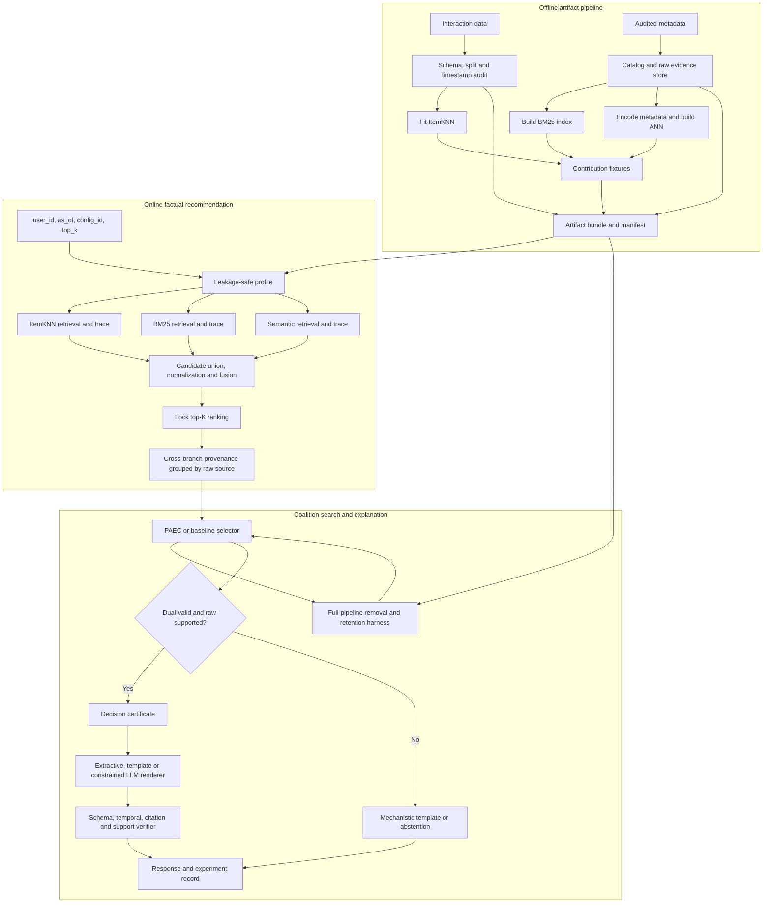
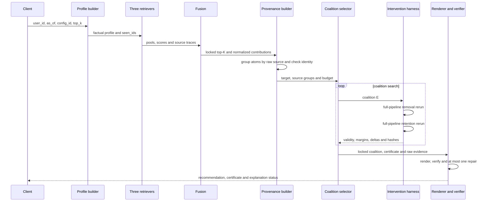

# Thiết kế hệ thống

> Tài liệu này chuyển mô hình nghiên cứu trong [qa.md](qa.md) và [research_design.md](research_design.md) thành kiến trúc triển khai cho frozen ItemKNN–BM25–Semantic ranker và cơ chế Pipeline-Aware Evidence Coalition (PAEC). Thiết kế ưu tiên khả năng tái lập, source-consistent intervention và tách ranking khỏi verbalization.

## 1. Mục tiêu và bất biến hệ thống

Hệ thống gồm ba luồng dùng chung artifact và manifest:

1. **offline artifact pipeline:** audit dữ liệu, xây ba retrieval artifact và fixture kiểm tra contribution;
2. **online recommendation pipeline:** tạo profile an toàn theo thời gian, chạy ba retriever, fusion và khóa top-$K$;
3. **explanation evaluation pipeline:** nhóm provenance theo raw source, tìm coalition, chạy removal/retention và sinh decision certificate trước khi render.

Các bất biến bắt buộc:

- target validation/test không được đi vào profile hoặc request phục vụ;
- ranking được khóa trước mọi bước chọn evidence và sinh ngôn ngữ;
- raw history source, không phải term hoặc semantic atom riêng lẻ, là đơn vị intervention;
- removal và retention phải dựng lại profile signal, query, ba candidate pool, union, normalization và boundary;
- factual `seen_ids`, model/index artifact, config và tie-break được giữ cố định trong primary intervention;
- LLM không được rerank, bổ sung fact ngoài evidence bundle hoặc thay decision certificate;
- run có ít hơn $K+1$ candidate sau fallback đã khóa là non-evaluable, không phải rank flip thành công.

## 2. Kiến trúc tổng thể



Luồng factual chỉ chạy một lần cho mỗi query. Intervention harness có thể chạy nhiều lần trong lúc selector tìm coalition, nhưng không được sửa recommendation factual đã khóa.

## 3. Artifact và dữ liệu dùng chung

### 3.1 Artifact bundle

| Thành phần | Nội dung tối thiểu |
|---|---|
| Interaction store | `user_id`, `item_id`, rating, timestamp, split, raw source ID |
| Catalog | `item_id`, title và metadata field đã audit |
| Raw evidence store | raw span, field, source hash và temporal status |
| ItemKNN | sparse interaction matrix, similarity matrix, mappings và clipping policy |
| BM25 | tokenizer, inverted index, IDF và mapping term về source/field |
| Semantic | encoder version, chunking rule, embedding, ANN index và raw text hash |
| Experiment config | fusion weight, pool size, $K$, budget $m$, tolerance, seed và tie-break |
| Manifest | schema, data, catalog, model, index, config và code version/hash |

Artifact là immutable trong một experiment run. Mọi factual, removal và retention run trong cùng certificate phải tham chiếu cùng manifest.

### 3.2 Profile theo thời điểm

`Profile(u,t)` chứa:

- `seen_ids`: mọi item đã tương tác trước `as_of`, dùng để lọc candidate;
- `positive_history`: interaction có rating từ 4 trở lên trước `as_of`;
- rating, timestamp, raw source ID và metadata hợp lệ của từng history item;
- history weight đã khóa cho ItemKNN và semantic branch;
- BM25 query material và semantic chunks dẫn xuất từ positive history.

Trong primary intervention, coalition chỉ thay đổi `positive_history` và các descendant của nó. `seen_ids` vẫn là tập của factual run để item đã xem không quay lại candidate set và tạo rank flip giả.

## 4. Factual ranking và provenance

### 4.1 Hợp đồng của retriever

Mỗi retriever trả về cả candidate score lẫn trace:

| Nhánh | Score | Provenance tối thiểu |
|---|---|---|
| ItemKNN | tổng similarity có trọng số từ history item | history source, candidate, edge score |
| BM25 | tổng contribution theo query term | source sinh term, history/candidate field, tokenizer/index version |
| Semantic | tổng similarity theo cặp history–candidate | history source, hai raw chunk, embedding/index version |

ANN chỉ được dùng để lấy candidate. Score semantic và provenance cuối phải được tính lại tất định trên embedding đã khóa.

### 4.2 Candidate union, normalization và fusion

Ba pool sau khi lọc factual `seen_ids` được hợp thành:

$$
C_u=C_{CF}\cup C_{BM25}\cup C_{SEM}.
$$

Với mỗi nhánh $r$, hệ thống chuẩn hóa score trong cùng query:

$$
\bar{s}_r(u,j)=
\frac{\max(s_r(u,j),0)}
{\epsilon+\sum_{k\in C_u}\max(s_r(u,k),0)}.
$$

Fused score là:

$$
s_F(u,j)=\sum_{r\in\{CF,BM25,SEM\}}\lambda_r\bar{s}_r(u,j).
$$

Pool size, fusion weight, tie-break và quy ước score của item ngoài pool phải được khóa trước test.

### 4.3 Cross-branch source trace

Mỗi provenance atom $p$ được ánh xạ về raw history source $g_i$. Source group của item lịch sử $i$ là:

$$
G_i=\{p\mid p\text{ được dẫn xuất từ }g_i\}.
$$

Attribution tĩnh của source $i$ đối với target $j$ là:

$$
A_i(u,j)=\sum_{p\in G_i}c_p^F(u,j).
$$

Provenance builder chỉ chấp nhận trace khi:

$$
\left|s_F(u,j)-\sum_i A_i(u,j)\right|<\delta.
$$

Đẳng thức này là kiểm tra accounting của factual score, không phải bằng chứng source là necessary hoặc sufficient.

### 4.4 Dependency DAG

Hệ thống lưu quan hệ phụ thuộc để kiểm tra intervention closure:

```text
raw history source
   +--> ItemKNN profile edge ------+
   +--> BM25 query terms ----------+--> branch candidate membership
   +--> semantic chunks -----------+             |
                                                 v
                                      branch score and trace
                                                 |
                                                 v
                                      candidate union and filter
                                                 |
                                                 v
                                      normalization denominator
                                                 |
                                                 v
                                      fused score, boundary, rank
```

Khi xóa source, mọi descendant trong DAG phải được tính lại. Nếu atom, query term hoặc semantic chunk dẫn xuất từ source bị xóa còn xuất hiện trong run mới, intervention run bị đánh dấu invalid.

## 5. PAEC và intervention harness

### 5.1 Giao diện rerun

Intervention harness nhận:

```text
factual_query
target_item_id
coalition_source_ids
mode = removal | retention
artifact_manifest_hash
```

Nó tạo history state:

- removal: $H_u^+(t)\setminus E$;
- retention: chỉ giữ $E$;

sau đó dựng lại toàn bộ ba nhánh, candidate union, normalization và ranking. Cả hai mode giữ factual `seen_ids` và cùng fallback policy.

### 5.2 Evaluable-state gate

Một state chỉ được dùng để kết luận validity khi:

1. artifact/config/hash khớp factual run;
2. intervention closure không còn descendant của source bị loại;
3. retrieval tất định hoặc dùng exact search trên evaluation subset;
4. pipeline trả ít nhất $K+1$ candidate sau fallback đã khóa;
5. target score, membership và boundary competitor được ghi theo cùng tie-break.

Nếu một điều kiện không đạt, case là `non_evaluable`; selector không được coi đó là dual-valid.

### 5.3 Margin và dual validity

Với history state $H$, signed boundary margin của target $j$ là:

$$
\mu_K(j;H)=
\begin{cases}
s_F(j;H)-s_F(j_{K+1};H), & j\in L^K(H),\\
s_F(j;H)-s_F(j_K;H), & j\notin L^K(H).
\end{cases}
$$

Removal effect và retention loss là:

$$
R^{-}(E;j)=\mu_K(j;H_u^+(t))-\mu_K(j;H_u^+(t)\setminus E),
$$

$$
R^{+}(E;j)=\left|\mu_K(j;H_u^+(t))-\mu_K(j;E)\right|.
$$

Coalition được gắn nhãn:

- `strict_removal_valid`: target rời top-$K$ trong removal run;
- `retention_valid`: target còn trong top-$K$ và retention loss không vượt tolerance;
- `dual_valid`: cả hai điều kiện trên đúng và cả hai run evaluable.

Nếu target không rời top-$K$ dù margin giảm mạnh, hệ thống chỉ ghi `soft_comprehensiveness`; không nâng thành strict validity.

### 5.4 Search controller

PAEC tối ưu tuần tự:

1. dual validity;
2. raw-span support cho loại claim dự kiến;
3. số raw source nhỏ hơn;
4. removal effect lớn hơn;
5. retention loss nhỏ hơn.

Với history không quá $h_{exact}$, controller liệt kê exhaustive theo từng tầng kích thước tăng dần. Sau khi đánh giá hết một tầng, controller dừng nếu tầng đó có coalition dual-valid và qua support gate; mọi coalition ở tầng lớn hơn chắc chắn thua theo objective ưu tiên số source nhỏ hơn. Trong tầng được chọn, mọi coalition vẫn được đánh giá để giữ tie-break theo removal effect và retention loss. Nếu chưa có tầng hợp lệ, search tiếp tục đến $m$. Với history dài, controller áp dụng cùng stopping rule cho bounded beam search. Quy tắc dừng theo kích thước không giả định intervention effect đơn điệu; branch-and-bound theo effect chỉ được bật khi bound đã được chứng minh admissible.

Các baseline random, recency, semantic, exact contribution, single-source leave-one-out và counterfactual set-greedy dùng cùng maximum raw-source budget. Mọi selector giải thích cùng target factual; không selector nào được đổi item cần giải thích.

### 5.5 Decision certificate

Mỗi coalition đã đánh giá tạo record:

```json
{
  "coalition_source_ids": ["H1", "H4"],
  "source_count": 2,
  "membership": {
    "factual": true,
    "removal": false,
    "retention": true
  },
  "margin": {
    "factual": 0.015,
    "removal": -0.022,
    "retention": 0.009
  },
  "removal_effect": 0.037,
  "retention_loss": 0.006,
  "boundary_items": {
    "factual": "movie_b",
    "removal": "movie_c",
    "retention": "movie_d"
  },
  "candidate_delta": {
    "removal_symmetric_difference": 12,
    "retention_symmetric_difference": 27
  },
  "run_hashes": {
    "factual": "run_f",
    "removal": "run_minus",
    "retention": "run_plus"
  },
  "artifact_manifest_hash": "artifact_v1",
  "config_hash": "config_v1",
  "strict_removal_valid": true,
  "retention_valid": true,
  "dual_valid": true,
  "evaluable": true
}
```

Certificate là sản phẩm kiểm chứng chính. Renderer chỉ được diễn đạt claim tương thích với certificate và evidence bundle.

## 6. Rendering, verification và fallback

### 6.1 Cùng coalition cho mọi renderer

Ba renderer nhận cùng coalition đã khóa:

- T0: raw-span/extractive presentation;
- T1: deterministic template;
- T2/T3: constrained LLM, với T3 có verifier, một lần repair và abstention.

Việc dùng cùng coalition cô lập tác động của verbalization khỏi tác động của evidence selection.

### 6.2 Evidence bundle

| ID | Nội dung |
|---|---|
| `[H#]` | interaction trước `as_of`, rating, timestamp và raw history metadata |
| `[C#]` | raw metadata field/span của candidate |
| `[P#]` | branch, source group, contribution và artifact version |
| `[S#]` | cặp raw span hai phía hỗ trợ semantic bridge |
| `[Z#]` | decision certificate của factual/removal/retention run |

Dense similarity không tự đủ để phát biểu hai item cùng chủ đề. Claim semantic chỉ được phép khi `[S#]` chứa raw support ở cả phía history và candidate.

### 6.3 Verification chain

```text
renderer output
   -> schema validation
   -> temporal validation
   -> citation existence and ownership
   -> contribution/provenance validation
   -> coalition/certificate validation
   -> raw-span semantic support
       | pass                    | fail
       v                         v
   verified output          one repair
                                  |
                           pass --+-- fail
                           |           |
                           v           v
                       verified    template or abstain
```

Nếu không có coalition vừa dual-valid vừa full-supported trong budget, hệ thống không phát biểu evidence “quyết định” recommendation. Nó chỉ trả mechanistic trace thận trọng hoặc:

```json
{
  "item_id": "movie_y",
  "explanation_status": "abstained",
  "claims": [],
  "abstain_reason": "no_supported_dual_valid_coalition_within_budget",
  "dual_valid": false
}
```

Recommendation factual vẫn được trả về khi phần giải thích abstain.

## 7. Luồng xử lý một request



## 8. Ví dụ xuyên suốt

Các ID và score dưới đây chỉ minh họa schema, không phải kết quả thực nghiệm.

### 8.1 Factual run

Tại `as_of = 2026-03-01T00:00:00Z`, người dùng `u17` có hai positive history source:

| Source | Item | Rating | Metadata rút gọn |
|---|---|---:|---|
| `H1` | `m101` — The Matrix | 5 | science fiction, action, simulated reality |
| `H2` | `m102` — Blade Runner | 4 | science fiction, future, android |

Interaction với `m202` ở test xảy ra sau `as_of`, vì vậy chỉ evaluator được đọc và không xuất hiện trong profile.

Ba retriever tạo factual union:

```text
ItemKNN : m201, m202, m203
BM25    : m201, m203, m202
Semantic: m201, m202, m204
Union   : {m201, m202, m203, m204}
```

Sau normalization và fusion, top-3 factual là:

| Rank | Candidate | Fused score |
|---:|---|---:|
| 1 | `m201` — Interstellar | 0.322 |
| 2 | `m202` — Arrival | 0.261 |
| 3 | `m203` — Dune | 0.246 |
| 4 | `m204` — Gravity | 0.171 |

Với target `m201`, boundary factual là `m204` và:

$$
\mu_3(m201;\{H1,H2\})=0.322-0.171=0.151.
$$

### 8.2 Source grouping và accounting

Provenance atom của `m201` được gom theo raw source:

| Source group | ItemKNN | BM25 | Semantic | Attribution $A_i$ |
|---|---:|---:|---:|---:|
| `G1` từ `H1` | 0.080 | 0.050 | 0.070 | 0.200 |
| `G2` từ `H2` | 0.056 | 0.040 | 0.026 | 0.122 |

Accounting validator kiểm tra:

$$
A_1+A_2=0.200+0.122=0.322=s_F(u17,m201).
$$

Selector contribution sẽ ưu tiên `H1`, nhưng PAEC chưa kết luận trước khi full-pipeline rerun.

### 8.3 Removal và retention

Giả sử PAEC thử coalition $E=\{H1\}$. Removal run xóa `H1` khỏi preference history nhưng vẫn giữ factual `seen_ids = {m101,m102}`. Hệ thống dựng lại BM25 query, semantic representation, cả ba pool, union và normalization:

```text
Removal state H = {H2}
  1. m203 Dune          0.265
  2. m202 Arrival       0.250
  3. m204 Gravity       0.180
  4. m201 Interstellar  0.150
```

Target `m201` rời top-3, nên `strict_removal_valid = true`. Retention run chỉ giữ `H1`; giả sử kết quả là:

```text
Retention state H = {H1}
  1. m201 Interstellar  0.310
  2. m202 Arrival       0.252
  3. m203 Dune          0.241
  4. m204 Gravity       0.175
```

Target vẫn ở top-3. Nếu retention loss so với factual margin không vượt tolerance đã khóa thì `retention_valid = true`, do đó coalition `H1` là dual-valid. Candidate và boundary của mỗi run được tính lại, không tái sử dụng factual pool.

Trong các số minh họa trên, removal margin là $0.150-0.180=-0.030$, retention margin là $0.310-0.175=0.135$, do đó $R^{-}=0.181$ và $R^{+}=0.016$.

### 8.4 Evidence, claim và response

Raw evidence bundle cho coalition gồm:

```text
[H1] u17 rated The Matrix 5/5 before as_of
[C1] Interstellar: "science fiction, space exploration, drama"
[P1] H1 contributes through ItemKNN
[P2] terms derived from H1 contribute through BM25
[P3] H1 and C1 form the selected semantic chunk pair
[S1] H1 and C1 both contain raw support for "science fiction"
[Z1] factual/removal/retention decision certificate for E={H1}
```

Một output hợp lệ có thể nói:

```text
Interstellar được gợi ý một phần từ tương tác tích cực của bạn với
The Matrix qua nhiều nhánh của hệ thống. Khi bỏ nguồn lịch sử này và
chạy lại toàn bộ pipeline, Interstellar rời top-3; khi chỉ giữ nguồn
này, phim vẫn nằm trong top-3. Metadata của hai phim hỗ trợ khía cạnh
"science fiction". [H1][C1][P1][P2][P3][S1][Z1]
```

Response giữ cả recommendation factual và certificate:

```json
{
  "rank": 1,
  "item_id": "m201",
  "scores": {
    "itemknn": 0.34,
    "bm25": 0.30,
    "semantic": 0.32,
    "fused": 0.322
  },
  "explanation_status": "verified",
  "contribution_coverage": 0.621,
  "coalition": {
    "history_source_ids": ["H1"],
    "source_count": 1,
    "removal_effect": 0.181,
    "retention_loss": 0.016,
    "strict_removal_valid": true,
    "retention_valid": true,
    "dual_valid": true,
    "certificate": {
      "certificate_id": "Z1",
      "run_hashes": {
        "factual": "run_f",
        "removal": "run_minus_h1",
        "retention": "run_plus_h1"
      },
      "boundary_items": {
        "factual": "m204",
        "removal": "m204",
        "retention": "m204"
      },
      "candidate_delta": {
        "removal_symmetric_difference": 2,
        "retention_symmetric_difference": 1
      },
      "artifact_manifest_hash": "artifact_v1",
      "config_hash": "config_v1"
    }
  },
  "claims": [
    {
      "claim_type": "semantic_bridge",
      "citations": ["H1", "C1", "P1", "P2", "P3", "S1", "Z1"]
    }
  ]
}
```

## 9. Luồng đánh giá và stagewise audit

Đánh giá tách bốn loại bằng chứng:

| Trục | Ground truth | Output chính |
|---|---|---|
| Score accounting | numerical identity của factual trace | residual và provenance precision |
| Decision influence | full-pipeline removal/retention | strict removal, retention và dual-valid rate |
| Claim support | raw history và candidate spans | support risk, coverage và AURC |
| Renderer utility | blind human rubric trên cùng coalition | usefulness, readability và stability |

Để định vị attribution–intervention gap, cùng coalition được chạy ở ba condition:

1. `score_only`: giữ factual pool và normalization denominator, chỉ tính lại numerator;
2. `fixed_pool`: giữ factual union nhưng tính lại score, normalization và boundary;
3. `full_pipeline`: dựng lại query, pool, union, normalization và boundary.

Chỉ `full_pipeline` được dùng để xác nhận dual validity. Chênh lệch `score_only`–`fixed_pool` mô tả normalization/boundary effect; chênh lệch `fixed_pool`–`full_pipeline` mô tả candidate-regeneration externality.

Experiment record phải báo thêm:

- Kendall's $\tau$ hoặc Spearman correlation giữa attribution và single-source removal effect;
- top-$q$ overlap và contribution-selector regret;
- candidate-membership/boundary-competitor change rate;
- interaction residual, synergy và redundancy;
- average coalition size, non-evaluable rate và search query count;
- validity gap, size gap và tie-break regret so với exact subset;
- latency, token và cost tách riêng ranking, search và rendering.

## 10. Module boundary và failure policy

| Module | Trách nhiệm | Failure policy |
|---|---|---|
| Data auditor | kiểm tra schema, split, timestamp và metadata field | dừng artifact build khi leakage hoặc schema sai |
| Artifact builder | tạo ba index và manifest tái lập | không publish bundle nếu fixture sai |
| Profile builder | tạo factual profile theo `as_of` | reject query nếu profile bất hợp lệ |
| Retriever/fusion | trả candidate, trace và ranking tất định | đánh dấu run invalid nếu rerun không ổn định |
| Provenance builder | group atom theo raw source và kiểm tra identity | dừng explanation nếu residual vượt $\delta$ |
| Selector | tìm coalition dưới cùng budget | không gọi heuristic coalition là minimal |
| Intervention harness | thực thi source-consistent full rerun | trả non-evaluable thay vì suy diễn rank flip |
| Certificate store | lưu hashes, margins, boundary và candidate delta | từ chối certificate lệch artifact/config |
| Renderer | diễn đạt coalition đã khóa | không thêm fact hoặc đổi recommendation |
| Verifier | kiểm tra schema, thời gian, citation và support | một repair, sau đó template hoặc abstain |
| Evaluator | ghép target sau inference và aggregate theo user | không gửi target vào serving path |

## 11. Kiểm thử bắt buộc trước experiment

1. **Temporal leakage test:** mọi `[H#]` có timestamp nhỏ hơn `as_of`; post-`as_of` rate bằng 0.
2. **Score identity test:** contribution cộng đúng branch score và fused score trong tolerance.
3. **Source-group closure test:** xóa source làm biến mất toàn bộ term, chunk và edge descendant.
4. **Deterministic rerun test:** hai factual rerun có cùng pool, score và rank.
5. **Seen-item invariance test:** primary removal/retention giữ factual `seen_ids`.
6. **Candidate regeneration test:** full-pipeline mode thực sự dựng lại ba pool và union.
7. **Evaluable-state test:** empty query hoặc ít hơn $K+1$ candidate không được tính là validity.
8. **Certificate integrity test:** hash, coalition, membership, margin, boundary và delta khớp run log.
9. **Selector parity test:** mọi selector dùng cùng target và maximum raw-source budget.
10. **Renderer isolation test:** T0, T1 và T2/T3 nhận đúng cùng coalition và evidence bundle.
11. **Fallback test:** verifier fail hai lần dẫn tới template hoặc abstention, không làm đổi ranking.
12. **Exact-reference test:** exhaustive solver trên history ngắn khớp brute-force fixture.

## 12. Phạm vi triển khai

Thiết kế này không coi citation, additive decomposition, deletion, retention, top-$K$ intervention hoặc LLM verbalization riêng lẻ là novelty. Phần cần hiện thực và kiểm chứng là cross-branch raw-source grouping, source-consistent intervention closure, attribution–intervention audit, PAEC dual validation và decision certificate trên cùng frozen pipeline.

Nếu attribution–intervention gap gần zero, PAEC không cải thiện strict dual-validity, hoặc raw support không đạt gate, hệ thống vẫn phải xuất kết quả null/failure tương ứng; không thay objective hoặc baseline sau khi xem test.
